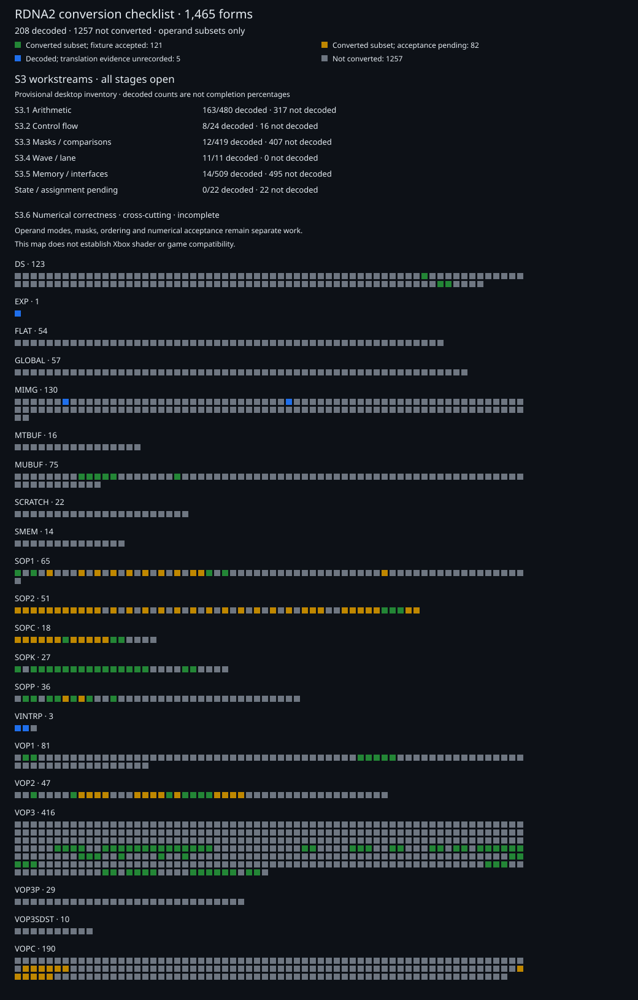

# Complete RDNA2 shader conversion checklist

Generated from the pinned AMD RDNA2 inventory, the handwritten and generated decoder identities, and [recorded evidence](../status.toml). Every one of the inventory’s **1,465 encoding forms** appears below, including unsupported forms. These are shader instructions, not Rust methods or runtime API functions. The same mnemonic in two encoding families is two forms.

For the Xbox Series X|S target and non-shader requirements, see the [master compatibility coverage map](../xbox-compatibility.md). This desktop inventory does not establish the console ISA, ABI or complete system compatibility. AnyPS5 was a documentation-layout reference only.



## Status meanings

| Status | Forms | Meaning |
| --- | ---: | --- |
| Converted subset; fixture accepted | 99 | Translation is recorded and the status registry records accepted native fixture evidence; only the documented operand subset is covered. |
| Converted subset; acceptance pending | 82 | Translation is recorded, but the registry does not record accepted native fixture evidence. This may reflect pending acceptance or documentation lag. |
| Decoded; translation evidence unrecorded | 5 | The decoder lists the form, but no translation evidence row is recorded. This is an evidence gap, not proof that lowering is absent. |
| Not converted | 1279 | No supported decoder identity exists. Opcode recognition from metadata alone does not implement execution. |

**Decoder coverage: 186/1465. Not yet decoded: 1279.**

No row means “all operand modes complete.” Sources, literals, modifiers, register widths, execution masks, graphics versus compute applicability, control-flow interactions and numerical behavior still require their own contracts and tests. This list covers the pinned inventory, not every future AMD instruction or every Xbox graphics method.

The evidence columns reproduce `docs/status.toml` without turning local readback or decoder support into independent acceptance. Historical rows can lag the newer [local checkpoints](../testing/local-graphics-checkpoint.md); reconcile their evidence before changing status. Missing CPU/GPU records mean unrecorded, not a test failure.

## Stage 3 planning map

**All S3 stages remain open.** See the [latest validated checkpoint](../testing/stage3-control-memory-opening.md) for bounded SCC1 branch and compute load-wait support. Wave/lane support is still unimplemented; masked bit count is the next researched candidate.

The partition below includes SOPP control flow and memory families alongside arithmetic. It is provisional, not a claim that a stage is complete or that forms outside arithmetic are optional. S3.6 numerical correctness applies across floating-point operations and is not counted as a disjoint opcode bucket. State assignments remain explicit gaps; scalar comparisons retain their historical arithmetic assignment pending a separate ownership audit. Counts exclude operand-mode debt such as DPP/SDWA, wave sizes, masks and ordering. The earlier 7/8/12 totals for S3.2/S3.4/S3.5 excluded whole families and were not stage completion denominators.

| Workstream | Total forms | Decoded | Not decoded |
| --- | ---: | ---: | ---: |
| S3.1 Arithmetic | 480 | 158 | 322 |
| S3.2 Control flow | 24 | 6 | 18 |
| S3.3 Masks / comparisons | 419 | 12 | 407 |
| S3.4 Wave / lane | 11 | 0 | 11 |
| S3.5 Memory / interfaces | 509 | 10 | 499 |
| State / assignment pending | 22 | 0 | 22 |

**158/480 arithmetic forms decoded is not 158 accepted or fully converted forms.** This distinction corrects the earlier shorthand used in progress updates.

## Families

| Family | Total | Fixture accepted | Acceptance pending | Evidence gap | Not converted |
| --- | ---: | ---: | ---: | ---: | ---: |
| [DS](#ds) | 123 | 0 | 0 | 0 | 123 |
| [EXP](#exp) | 1 | 0 | 0 | 1 | 0 |
| [FLAT](#flat) | 54 | 0 | 0 | 0 | 54 |
| [GLOBAL](#global) | 57 | 0 | 0 | 0 | 57 |
| [MIMG](#mimg) | 130 | 0 | 0 | 2 | 128 |
| [MTBUF](#mtbuf) | 16 | 0 | 0 | 0 | 16 |
| [MUBUF](#mubuf) | 75 | 2 | 0 | 0 | 73 |
| [SCRATCH](#scratch) | 22 | 0 | 0 | 0 | 22 |
| [SMEM](#smem) | 14 | 0 | 0 | 0 | 14 |
| [SOP1](#sop1) | 65 | 4 | 11 | 0 | 50 |
| [SOP2](#sop2) | 51 | 3 | 33 | 0 | 15 |
| [SOPC](#sopc) | 18 | 3 | 11 | 0 | 4 |
| [SOPK](#sopk) | 27 | 18 | 0 | 0 | 9 |
| [SOPP](#sopp) | 36 | 5 | 2 | 0 | 29 |
| [VINTRP](#vintrp) | 3 | 0 | 0 | 2 | 1 |
| [VOP1](#vop1) | 81 | 6 | 0 | 0 | 75 |
| [VOP2](#vop2) | 47 | 7 | 13 | 0 | 27 |
| [VOP3](#vop3) | 416 | 51 | 0 | 0 | 365 |
| [VOP3P](#vop3p) | 29 | 0 | 0 | 0 | 29 |
| [VOP3SDST](#vop3sdst) | 10 | 0 | 0 | 0 | 10 |
| [VOPC](#vopc) | 190 | 0 | 12 | 0 | 178 |

## Regenerate and validate

From the repository root:

```sh
python3 scripts/audit/shader_checklist.py
python3 scripts/audit/shader_checklist.py --check
```

Update the implementation and its evidence in `docs/status.toml`, then regenerate. The check compares every generated row and the map against current sources. CI and the full graphics-validation status gate run this check automatically. Do not hand-edit generated rows. The narrower [evidence table](instruction-coverage.md) retains operand contracts and validation details. The source snapshot and attribution are in [rdna2.jsonl](../../crates/isa/data/rdna2.jsonl).

## DS

| OP | Instruction | Conversion status | Recorded lowering | CPU evidence | GPU evidence |
| ---: | --- | --- | --- | --- | --- |
| 0 | `DS_ADD_U32` | Not converted | — | — | — |
| 1 | `DS_SUB_U32` | Not converted | — | — | — |
| 2 | `DS_RSUB_U32` | Not converted | — | — | — |
| 3 | `DS_INC_U32` | Not converted | — | — | — |
| 4 | `DS_DEC_U32` | Not converted | — | — | — |
| 5 | `DS_MIN_I32` | Not converted | — | — | — |
| 6 | `DS_MAX_I32` | Not converted | — | — | — |
| 7 | `DS_MIN_U32` | Not converted | — | — | — |
| 8 | `DS_MAX_U32` | Not converted | — | — | — |
| 9 | `DS_AND_B32` | Not converted | — | — | — |
| 10 | `DS_OR_B32` | Not converted | — | — | — |
| 11 | `DS_XOR_B32` | Not converted | — | — | — |
| 12 | `DS_MSKOR_B32` | Not converted | — | — | — |
| 13 | `DS_WRITE_B32` | Not converted | — | — | — |
| 14 | `DS_WRITE2_B32` | Not converted | — | — | — |
| 15 | `DS_WRITE2ST64_B32` | Not converted | — | — | — |
| 16 | `DS_CMPST_B32` | Not converted | — | — | — |
| 17 | `DS_CMPST_F32` | Not converted | — | — | — |
| 18 | `DS_MIN_F32` | Not converted | — | — | — |
| 19 | `DS_MAX_F32` | Not converted | — | — | — |
| 20 | `DS_NOP` | Not converted | — | — | — |
| 21 | `DS_ADD_F32` | Not converted | — | — | — |
| 24 | `DS_GWS_SEMA_RELEASE_ALL` | Not converted | — | — | — |
| 25 | `DS_GWS_INIT` | Not converted | — | — | — |
| 26 | `DS_GWS_SEMA_V` | Not converted | — | — | — |
| 27 | `DS_GWS_SEMA_BR` | Not converted | — | — | — |
| 28 | `DS_GWS_SEMA_P` | Not converted | — | — | — |
| 29 | `DS_GWS_BARRIER` | Not converted | — | — | — |
| 30 | `DS_WRITE_B8` | Not converted | — | — | — |
| 31 | `DS_WRITE_B16` | Not converted | — | — | — |
| 32 | `DS_ADD_RTN_U32` | Not converted | — | — | — |
| 33 | `DS_SUB_RTN_U32` | Not converted | — | — | — |
| 34 | `DS_RSUB_RTN_U32` | Not converted | — | — | — |
| 35 | `DS_INC_RTN_U32` | Not converted | — | — | — |
| 36 | `DS_DEC_RTN_U32` | Not converted | — | — | — |
| 37 | `DS_MIN_RTN_I32` | Not converted | — | — | — |
| 38 | `DS_MAX_RTN_I32` | Not converted | — | — | — |
| 39 | `DS_MIN_RTN_U32` | Not converted | — | — | — |
| 40 | `DS_MAX_RTN_U32` | Not converted | — | — | — |
| 41 | `DS_AND_RTN_B32` | Not converted | — | — | — |
| 42 | `DS_OR_RTN_B32` | Not converted | — | — | — |
| 43 | `DS_XOR_RTN_B32` | Not converted | — | — | — |
| 44 | `DS_MSKOR_RTN_B32` | Not converted | — | — | — |
| 45 | `DS_WRXCHG_RTN_B32` | Not converted | — | — | — |
| 46 | `DS_WRXCHG2_RTN_B32` | Not converted | — | — | — |
| 47 | `DS_WRXCHG2ST64_RTN_B32` | Not converted | — | — | — |
| 48 | `DS_CMPST_RTN_B32` | Not converted | — | — | — |
| 49 | `DS_CMPST_RTN_F32` | Not converted | — | — | — |
| 50 | `DS_MIN_RTN_F32` | Not converted | — | — | — |
| 51 | `DS_MAX_RTN_F32` | Not converted | — | — | — |
| 52 | `DS_WRAP_RTN_B32` | Not converted | — | — | — |
| 53 | `DS_SWIZZLE_B32` | Not converted | — | — | — |
| 54 | `DS_READ_B32` | Not converted | — | — | — |
| 55 | `DS_READ2_B32` | Not converted | — | — | — |
| 56 | `DS_READ2ST64_B32` | Not converted | — | — | — |
| 57 | `DS_READ_I8` | Not converted | — | — | — |
| 58 | `DS_READ_U8` | Not converted | — | — | — |
| 59 | `DS_READ_I16` | Not converted | — | — | — |
| 60 | `DS_READ_U16` | Not converted | — | — | — |
| 61 | `DS_CONSUME` | Not converted | — | — | — |
| 62 | `DS_APPEND` | Not converted | — | — | — |
| 63 | `DS_ORDERED_COUNT` | Not converted | — | — | — |
| 64 | `DS_ADD_U64` | Not converted | — | — | — |
| 65 | `DS_SUB_U64` | Not converted | — | — | — |
| 66 | `DS_RSUB_U64` | Not converted | — | — | — |
| 67 | `DS_INC_U64` | Not converted | — | — | — |
| 68 | `DS_DEC_U64` | Not converted | — | — | — |
| 69 | `DS_MIN_I64` | Not converted | — | — | — |
| 70 | `DS_MAX_I64` | Not converted | — | — | — |
| 71 | `DS_MIN_U64` | Not converted | — | — | — |
| 72 | `DS_MAX_U64` | Not converted | — | — | — |
| 73 | `DS_AND_B64` | Not converted | — | — | — |
| 74 | `DS_OR_B64` | Not converted | — | — | — |
| 75 | `DS_XOR_B64` | Not converted | — | — | — |
| 76 | `DS_MSKOR_B64` | Not converted | — | — | — |
| 77 | `DS_WRITE_B64` | Not converted | — | — | — |
| 78 | `DS_WRITE2_B64` | Not converted | — | — | — |
| 79 | `DS_WRITE2ST64_B64` | Not converted | — | — | — |
| 80 | `DS_CMPST_B64` | Not converted | — | — | — |
| 81 | `DS_CMPST_F64` | Not converted | — | — | — |
| 82 | `DS_MIN_F64` | Not converted | — | — | — |
| 83 | `DS_MAX_F64` | Not converted | — | — | — |
| 85 | `DS_ADD_RTN_F32` | Not converted | — | — | — |
| 96 | `DS_ADD_RTN_U64` | Not converted | — | — | — |
| 97 | `DS_SUB_RTN_U64` | Not converted | — | — | — |
| 98 | `DS_RSUB_RTN_U64` | Not converted | — | — | — |
| 99 | `DS_INC_RTN_U64` | Not converted | — | — | — |
| 100 | `DS_DEC_RTN_U64` | Not converted | — | — | — |
| 101 | `DS_MIN_RTN_I64` | Not converted | — | — | — |
| 102 | `DS_MAX_RTN_I64` | Not converted | — | — | — |
| 103 | `DS_MIN_RTN_U64` | Not converted | — | — | — |
| 104 | `DS_MAX_RTN_U64` | Not converted | — | — | — |
| 105 | `DS_AND_RTN_B64` | Not converted | — | — | — |
| 106 | `DS_OR_RTN_B64` | Not converted | — | — | — |
| 107 | `DS_XOR_RTN_B64` | Not converted | — | — | — |
| 108 | `DS_MSKOR_RTN_B64` | Not converted | — | — | — |
| 109 | `DS_WRXCHG_RTN_B64` | Not converted | — | — | — |
| 110 | `DS_WRXCHG2_RTN_B64` | Not converted | — | — | — |
| 111 | `DS_WRXCHG2ST64_RTN_B64` | Not converted | — | — | — |
| 112 | `DS_CMPST_RTN_B64` | Not converted | — | — | — |
| 113 | `DS_CMPST_RTN_F64` | Not converted | — | — | — |
| 114 | `DS_MIN_RTN_F64` | Not converted | — | — | — |
| 115 | `DS_MAX_RTN_F64` | Not converted | — | — | — |
| 118 | `DS_READ_B64` | Not converted | — | — | — |
| 119 | `DS_READ2_B64` | Not converted | — | — | — |
| 120 | `DS_READ2ST64_B64` | Not converted | — | — | — |
| 126 | `DS_CONDXCHG32_RTN_B64` | Not converted | — | — | — |
| 160 | `DS_WRITE_B8_D16_HI` | Not converted | — | — | — |
| 161 | `DS_WRITE_B16_D16_HI` | Not converted | — | — | — |
| 162 | `DS_READ_U8_D16` | Not converted | — | — | — |
| 163 | `DS_READ_U8_D16_HI` | Not converted | — | — | — |
| 164 | `DS_READ_I8_D16` | Not converted | — | — | — |
| 165 | `DS_READ_I8_D16_HI` | Not converted | — | — | — |
| 166 | `DS_READ_U16_D16` | Not converted | — | — | — |
| 167 | `DS_READ_U16_D16_HI` | Not converted | — | — | — |
| 176 | `DS_WRITE_ADDTID_B32` | Not converted | — | — | — |
| 177 | `DS_READ_ADDTID_B32` | Not converted | — | — | — |
| 178 | `DS_PERMUTE_B32` | Not converted | — | — | — |
| 179 | `DS_BPERMUTE_B32` | Not converted | — | — | — |
| 222 | `DS_WRITE_B96` | Not converted | — | — | — |
| 223 | `DS_WRITE_B128` | Not converted | — | — | — |
| 254 | `DS_READ_B96` | Not converted | — | — | — |
| 255 | `DS_READ_B128` | Not converted | — | — | — |

## EXP

| OP | Instruction | Conversion status | Recorded lowering | CPU evidence | GPU evidence |
| ---: | --- | --- | --- | --- | --- |
| 0 | `EXP` | Decoded; translation evidence unrecorded | — | — | — |

## FLAT

| OP | Instruction | Conversion status | Recorded lowering | CPU evidence | GPU evidence |
| ---: | --- | --- | --- | --- | --- |
| 8 | `FLAT_LOAD_UBYTE` | Not converted | — | — | — |
| 9 | `FLAT_LOAD_SBYTE` | Not converted | — | — | — |
| 10 | `FLAT_LOAD_USHORT` | Not converted | — | — | — |
| 11 | `FLAT_LOAD_SSHORT` | Not converted | — | — | — |
| 12 | `FLAT_LOAD_DWORD` | Not converted | — | — | — |
| 13 | `FLAT_LOAD_DWORDX2` | Not converted | — | — | — |
| 14 | `FLAT_LOAD_DWORDX4` | Not converted | — | — | — |
| 15 | `FLAT_LOAD_DWORDX3` | Not converted | — | — | — |
| 24 | `FLAT_STORE_BYTE` | Not converted | — | — | — |
| 25 | `FLAT_STORE_BYTE_D16_HI` | Not converted | — | — | — |
| 26 | `FLAT_STORE_SHORT` | Not converted | — | — | — |
| 27 | `FLAT_STORE_SHORT_D16_HI` | Not converted | — | — | — |
| 28 | `FLAT_STORE_DWORD` | Not converted | — | — | — |
| 29 | `FLAT_STORE_DWORDX2` | Not converted | — | — | — |
| 30 | `FLAT_STORE_DWORDX4` | Not converted | — | — | — |
| 31 | `FLAT_STORE_DWORDX3` | Not converted | — | — | — |
| 32 | `FLAT_LOAD_UBYTE_D16` | Not converted | — | — | — |
| 33 | `FLAT_LOAD_UBYTE_D16_HI` | Not converted | — | — | — |
| 34 | `FLAT_LOAD_SBYTE_D16` | Not converted | — | — | — |
| 35 | `FLAT_LOAD_SBYTE_D16_HI` | Not converted | — | — | — |
| 36 | `FLAT_LOAD_SHORT_D16` | Not converted | — | — | — |
| 37 | `FLAT_LOAD_SHORT_D16_HI` | Not converted | — | — | — |
| 48 | `FLAT_ATOMIC_SWAP` | Not converted | — | — | — |
| 49 | `FLAT_ATOMIC_CMPSWAP` | Not converted | — | — | — |
| 50 | `FLAT_ATOMIC_ADD` | Not converted | — | — | — |
| 51 | `FLAT_ATOMIC_SUB` | Not converted | — | — | — |
| 53 | `FLAT_ATOMIC_SMIN` | Not converted | — | — | — |
| 54 | `FLAT_ATOMIC_UMIN` | Not converted | — | — | — |
| 55 | `FLAT_ATOMIC_SMAX` | Not converted | — | — | — |
| 56 | `FLAT_ATOMIC_UMAX` | Not converted | — | — | — |
| 57 | `FLAT_ATOMIC_AND` | Not converted | — | — | — |
| 58 | `FLAT_ATOMIC_OR` | Not converted | — | — | — |
| 59 | `FLAT_ATOMIC_XOR` | Not converted | — | — | — |
| 60 | `FLAT_ATOMIC_INC` | Not converted | — | — | — |
| 61 | `FLAT_ATOMIC_DEC` | Not converted | — | — | — |
| 62 | `FLAT_ATOMIC_FCMPSWAP` | Not converted | — | — | — |
| 63 | `FLAT_ATOMIC_FMIN` | Not converted | — | — | — |
| 64 | `FLAT_ATOMIC_FMAX` | Not converted | — | — | — |
| 80 | `FLAT_ATOMIC_SWAP_X2` | Not converted | — | — | — |
| 81 | `FLAT_ATOMIC_CMPSWAP_X2` | Not converted | — | — | — |
| 82 | `FLAT_ATOMIC_ADD_X2` | Not converted | — | — | — |
| 83 | `FLAT_ATOMIC_SUB_X2` | Not converted | — | — | — |
| 85 | `FLAT_ATOMIC_SMIN_X2` | Not converted | — | — | — |
| 86 | `FLAT_ATOMIC_UMIN_X2` | Not converted | — | — | — |
| 87 | `FLAT_ATOMIC_SMAX_X2` | Not converted | — | — | — |
| 88 | `FLAT_ATOMIC_UMAX_X2` | Not converted | — | — | — |
| 89 | `FLAT_ATOMIC_AND_X2` | Not converted | — | — | — |
| 90 | `FLAT_ATOMIC_OR_X2` | Not converted | — | — | — |
| 91 | `FLAT_ATOMIC_XOR_X2` | Not converted | — | — | — |
| 92 | `FLAT_ATOMIC_INC_X2` | Not converted | — | — | — |
| 93 | `FLAT_ATOMIC_DEC_X2` | Not converted | — | — | — |
| 94 | `FLAT_ATOMIC_FCMPSWAP_X2` | Not converted | — | — | — |
| 95 | `FLAT_ATOMIC_FMIN_X2` | Not converted | — | — | — |
| 96 | `FLAT_ATOMIC_FMAX_X2` | Not converted | — | — | — |

## GLOBAL

| OP | Instruction | Conversion status | Recorded lowering | CPU evidence | GPU evidence |
| ---: | --- | --- | --- | --- | --- |
| 8 | `GLOBAL_LOAD_UBYTE` | Not converted | — | — | — |
| 9 | `GLOBAL_LOAD_SBYTE` | Not converted | — | — | — |
| 10 | `GLOBAL_LOAD_USHORT` | Not converted | — | — | — |
| 11 | `GLOBAL_LOAD_SSHORT` | Not converted | — | — | — |
| 12 | `GLOBAL_LOAD_DWORD` | Not converted | — | — | — |
| 13 | `GLOBAL_LOAD_DWORDX2` | Not converted | — | — | — |
| 14 | `GLOBAL_LOAD_DWORDX4` | Not converted | — | — | — |
| 15 | `GLOBAL_LOAD_DWORDX3` | Not converted | — | — | — |
| 22 | `GLOBAL_LOAD_DWORD_ADDTID` | Not converted | — | — | — |
| 23 | `GLOBAL_STORE_DWORD_ADDTID` | Not converted | — | — | — |
| 24 | `GLOBAL_STORE_BYTE` | Not converted | — | — | — |
| 25 | `GLOBAL_STORE_BYTE_D16_HI` | Not converted | — | — | — |
| 26 | `GLOBAL_STORE_SHORT` | Not converted | — | — | — |
| 27 | `GLOBAL_STORE_SHORT_D16_HI` | Not converted | — | — | — |
| 28 | `GLOBAL_STORE_DWORD` | Not converted | — | — | — |
| 29 | `GLOBAL_STORE_DWORDX2` | Not converted | — | — | — |
| 30 | `GLOBAL_STORE_DWORDX4` | Not converted | — | — | — |
| 31 | `GLOBAL_STORE_DWORDX3` | Not converted | — | — | — |
| 32 | `GLOBAL_LOAD_UBYTE_D16` | Not converted | — | — | — |
| 33 | `GLOBAL_LOAD_UBYTE_D16_HI` | Not converted | — | — | — |
| 34 | `GLOBAL_LOAD_SBYTE_D16` | Not converted | — | — | — |
| 35 | `GLOBAL_LOAD_SBYTE_D16_HI` | Not converted | — | — | — |
| 36 | `GLOBAL_LOAD_SHORT_D16` | Not converted | — | — | — |
| 37 | `GLOBAL_LOAD_SHORT_D16_HI` | Not converted | — | — | — |
| 48 | `GLOBAL_ATOMIC_SWAP` | Not converted | — | — | — |
| 49 | `GLOBAL_ATOMIC_CMPSWAP` | Not converted | — | — | — |
| 50 | `GLOBAL_ATOMIC_ADD` | Not converted | — | — | — |
| 51 | `GLOBAL_ATOMIC_SUB` | Not converted | — | — | — |
| 52 | `GLOBAL_ATOMIC_CSUB` | Not converted | — | — | — |
| 53 | `GLOBAL_ATOMIC_SMIN` | Not converted | — | — | — |
| 54 | `GLOBAL_ATOMIC_UMIN` | Not converted | — | — | — |
| 55 | `GLOBAL_ATOMIC_SMAX` | Not converted | — | — | — |
| 56 | `GLOBAL_ATOMIC_UMAX` | Not converted | — | — | — |
| 57 | `GLOBAL_ATOMIC_AND` | Not converted | — | — | — |
| 58 | `GLOBAL_ATOMIC_OR` | Not converted | — | — | — |
| 59 | `GLOBAL_ATOMIC_XOR` | Not converted | — | — | — |
| 60 | `GLOBAL_ATOMIC_INC` | Not converted | — | — | — |
| 61 | `GLOBAL_ATOMIC_DEC` | Not converted | — | — | — |
| 62 | `GLOBAL_ATOMIC_FCMPSWAP` | Not converted | — | — | — |
| 63 | `GLOBAL_ATOMIC_FMIN` | Not converted | — | — | — |
| 64 | `GLOBAL_ATOMIC_FMAX` | Not converted | — | — | — |
| 80 | `GLOBAL_ATOMIC_SWAP_X2` | Not converted | — | — | — |
| 81 | `GLOBAL_ATOMIC_CMPSWAP_X2` | Not converted | — | — | — |
| 82 | `GLOBAL_ATOMIC_ADD_X2` | Not converted | — | — | — |
| 83 | `GLOBAL_ATOMIC_SUB_X2` | Not converted | — | — | — |
| 85 | `GLOBAL_ATOMIC_SMIN_X2` | Not converted | — | — | — |
| 86 | `GLOBAL_ATOMIC_UMIN_X2` | Not converted | — | — | — |
| 87 | `GLOBAL_ATOMIC_SMAX_X2` | Not converted | — | — | — |
| 88 | `GLOBAL_ATOMIC_UMAX_X2` | Not converted | — | — | — |
| 89 | `GLOBAL_ATOMIC_AND_X2` | Not converted | — | — | — |
| 90 | `GLOBAL_ATOMIC_OR_X2` | Not converted | — | — | — |
| 91 | `GLOBAL_ATOMIC_XOR_X2` | Not converted | — | — | — |
| 92 | `GLOBAL_ATOMIC_INC_X2` | Not converted | — | — | — |
| 93 | `GLOBAL_ATOMIC_DEC_X2` | Not converted | — | — | — |
| 94 | `GLOBAL_ATOMIC_FCMPSWAP_X2` | Not converted | — | — | — |
| 95 | `GLOBAL_ATOMIC_FMIN_X2` | Not converted | — | — | — |
| 96 | `GLOBAL_ATOMIC_FMAX_X2` | Not converted | — | — | — |

## MIMG

| OP | Instruction | Conversion status | Recorded lowering | CPU evidence | GPU evidence |
| ---: | --- | --- | --- | --- | --- |
| 0 | `IMAGE_LOAD` | Not converted | — | — | — |
| 1 | `IMAGE_LOAD_MIP` | Not converted | — | — | — |
| 2 | `IMAGE_LOAD_PCK` | Not converted | — | — | — |
| 3 | `IMAGE_LOAD_PCK_SGN` | Not converted | — | — | — |
| 4 | `IMAGE_LOAD_MIP_PCK` | Not converted | — | — | — |
| 5 | `IMAGE_LOAD_MIP_PCK_SGN` | Not converted | — | — | — |
| 8 | `IMAGE_STORE` | Decoded; translation evidence unrecorded | — | — | — |
| 9 | `IMAGE_STORE_MIP` | Not converted | — | — | — |
| 10 | `IMAGE_STORE_PCK` | Not converted | — | — | — |
| 11 | `IMAGE_STORE_MIP_PCK` | Not converted | — | — | — |
| 14 | `IMAGE_GET_RESINFO` | Not converted | — | — | — |
| 15 | `IMAGE_ATOMIC_SWAP` | Not converted | — | — | — |
| 16 | `IMAGE_ATOMIC_CMPSWAP` | Not converted | — | — | — |
| 17 | `IMAGE_ATOMIC_ADD` | Not converted | — | — | — |
| 18 | `IMAGE_ATOMIC_SUB` | Not converted | — | — | — |
| 20 | `IMAGE_ATOMIC_SMIN` | Not converted | — | — | — |
| 21 | `IMAGE_ATOMIC_UMIN` | Not converted | — | — | — |
| 22 | `IMAGE_ATOMIC_SMAX` | Not converted | — | — | — |
| 23 | `IMAGE_ATOMIC_UMAX` | Not converted | — | — | — |
| 24 | `IMAGE_ATOMIC_AND` | Not converted | — | — | — |
| 25 | `IMAGE_ATOMIC_OR` | Not converted | — | — | — |
| 26 | `IMAGE_ATOMIC_XOR` | Not converted | — | — | — |
| 27 | `IMAGE_ATOMIC_INC` | Not converted | — | — | — |
| 28 | `IMAGE_ATOMIC_DEC` | Not converted | — | — | — |
| 29 | `IMAGE_ATOMIC_FCMPSWAP` | Not converted | — | — | — |
| 30 | `IMAGE_ATOMIC_FMIN` | Not converted | — | — | — |
| 31 | `IMAGE_ATOMIC_FMAX` | Not converted | — | — | — |
| 32 | `IMAGE_SAMPLE` | Not converted | — | — | — |
| 33 | `IMAGE_SAMPLE_CL` | Not converted | — | — | — |
| 34 | `IMAGE_SAMPLE_D` | Not converted | — | — | — |
| 35 | `IMAGE_SAMPLE_D_CL` | Not converted | — | — | — |
| 36 | `IMAGE_SAMPLE_L` | Not converted | — | — | — |
| 37 | `IMAGE_SAMPLE_B` | Not converted | — | — | — |
| 38 | `IMAGE_SAMPLE_B_CL` | Not converted | — | — | — |
| 39 | `IMAGE_SAMPLE_LZ` | Decoded; translation evidence unrecorded | — | — | — |
| 40 | `IMAGE_SAMPLE_C` | Not converted | — | — | — |
| 41 | `IMAGE_SAMPLE_C_CL` | Not converted | — | — | — |
| 42 | `IMAGE_SAMPLE_C_D` | Not converted | — | — | — |
| 43 | `IMAGE_SAMPLE_C_D_CL` | Not converted | — | — | — |
| 44 | `IMAGE_SAMPLE_C_L` | Not converted | — | — | — |
| 45 | `IMAGE_SAMPLE_C_B` | Not converted | — | — | — |
| 46 | `IMAGE_SAMPLE_C_B_CL` | Not converted | — | — | — |
| 47 | `IMAGE_SAMPLE_C_LZ` | Not converted | — | — | — |
| 48 | `IMAGE_SAMPLE_O` | Not converted | — | — | — |
| 49 | `IMAGE_SAMPLE_CL_O` | Not converted | — | — | — |
| 50 | `IMAGE_SAMPLE_D_O` | Not converted | — | — | — |
| 51 | `IMAGE_SAMPLE_D_CL_O` | Not converted | — | — | — |
| 52 | `IMAGE_SAMPLE_L_O` | Not converted | — | — | — |
| 53 | `IMAGE_SAMPLE_B_O` | Not converted | — | — | — |
| 54 | `IMAGE_SAMPLE_B_CL_O` | Not converted | — | — | — |
| 55 | `IMAGE_SAMPLE_LZ_O` | Not converted | — | — | — |
| 56 | `IMAGE_SAMPLE_C_O` | Not converted | — | — | — |
| 57 | `IMAGE_SAMPLE_C_CL_O` | Not converted | — | — | — |
| 58 | `IMAGE_SAMPLE_C_D_O` | Not converted | — | — | — |
| 59 | `IMAGE_SAMPLE_C_D_CL_O` | Not converted | — | — | — |
| 60 | `IMAGE_SAMPLE_C_L_O` | Not converted | — | — | — |
| 61 | `IMAGE_SAMPLE_C_B_O` | Not converted | — | — | — |
| 62 | `IMAGE_SAMPLE_C_B_CL_O` | Not converted | — | — | — |
| 63 | `IMAGE_SAMPLE_C_LZ_O` | Not converted | — | — | — |
| 64 | `IMAGE_GATHER4` | Not converted | — | — | — |
| 65 | `IMAGE_GATHER4_CL` | Not converted | — | — | — |
| 66 | `IMAGE_LOAD_BY2` | Not converted | — | — | — |
| 67 | `IMAGE_LOAD_BY4` | Not converted | — | — | — |
| 68 | `IMAGE_GATHER4_L` | Not converted | — | — | — |
| 69 | `IMAGE_GATHER4_B` | Not converted | — | — | — |
| 70 | `IMAGE_GATHER4_B_CL` | Not converted | — | — | — |
| 71 | `IMAGE_GATHER4_LZ` | Not converted | — | — | — |
| 72 | `IMAGE_GATHER4_C` | Not converted | — | — | — |
| 73 | `IMAGE_GATHER4_C_CL` | Not converted | — | — | — |
| 74 | `IMAGE_LOAD_MIP_BY2` | Not converted | — | — | — |
| 75 | `IMAGE_LOAD_MIP_BY4` | Not converted | — | — | — |
| 76 | `IMAGE_GATHER4_C_L` | Not converted | — | — | — |
| 77 | `IMAGE_GATHER4_C_B` | Not converted | — | — | — |
| 78 | `IMAGE_GATHER4_C_B_CL` | Not converted | — | — | — |
| 79 | `IMAGE_GATHER4_C_LZ` | Not converted | — | — | — |
| 80 | `IMAGE_GATHER4_O` | Not converted | — | — | — |
| 81 | `IMAGE_GATHER4_CL_O` | Not converted | — | — | — |
| 82 | `IMAGE_STORE_BY2` | Not converted | — | — | — |
| 83 | `IMAGE_STORE_BY4` | Not converted | — | — | — |
| 84 | `IMAGE_GATHER4_L_O` | Not converted | — | — | — |
| 85 | `IMAGE_GATHER4_B_O` | Not converted | — | — | — |
| 86 | `IMAGE_GATHER4_B_CL_O` | Not converted | — | — | — |
| 87 | `IMAGE_GATHER4_LZ_O` | Not converted | — | — | — |
| 88 | `IMAGE_GATHER4_C_O` | Not converted | — | — | — |
| 89 | `IMAGE_GATHER4_C_CL_O` | Not converted | — | — | — |
| 90 | `IMAGE_STORE_MIP_BY2` | Not converted | — | — | — |
| 91 | `IMAGE_STORE_MIP_BY4` | Not converted | — | — | — |
| 92 | `IMAGE_GATHER4_C_L_O` | Not converted | — | — | — |
| 93 | `IMAGE_GATHER4_C_B_O` | Not converted | — | — | — |
| 94 | `IMAGE_GATHER4_C_B_CL_O` | Not converted | — | — | — |
| 95 | `IMAGE_GATHER4_C_LZ_O` | Not converted | — | — | — |
| 96 | `IMAGE_GET_LOD` | Not converted | — | — | — |
| 97 | `IMAGE_GATHER4H` | Not converted | — | — | — |
| 98 | `IMAGE_GATHER4H_PCK` | Not converted | — | — | — |
| 99 | `IMAGE_GATHER8H_PCK` | Not converted | — | — | — |
| 104 | `IMAGE_SAMPLE_CD` | Not converted | — | — | — |
| 105 | `IMAGE_SAMPLE_CD_CL` | Not converted | — | — | — |
| 106 | `IMAGE_SAMPLE_C_CD` | Not converted | — | — | — |
| 107 | `IMAGE_SAMPLE_C_CD_CL` | Not converted | — | — | — |
| 108 | `IMAGE_SAMPLE_CD_O` | Not converted | — | — | — |
| 109 | `IMAGE_SAMPLE_CD_CL_O` | Not converted | — | — | — |
| 110 | `IMAGE_SAMPLE_C_CD_O` | Not converted | — | — | — |
| 111 | `IMAGE_SAMPLE_C_CD_CL_O` | Not converted | — | — | — |
| 112 | `IMAGE_LOAD_PCK2` | Not converted | — | — | — |
| 113 | `IMAGE_LOAD_PCK4` | Not converted | — | — | — |
| 115 | `IMAGE_LOAD_MIP_PCK2` | Not converted | — | — | — |
| 116 | `IMAGE_LOAD_MIP_PCK4` | Not converted | — | — | — |
| 118 | `IMAGE_STORE_PCK2` | Not converted | — | — | — |
| 119 | `IMAGE_STORE_PCK4` | Not converted | — | — | — |
| 121 | `IMAGE_STORE_MIP_PCK2` | Not converted | — | — | — |
| 122 | `IMAGE_STORE_MIP_PCK4` | Not converted | — | — | — |
| 128 | `IMAGE_MSAA_LOAD` | Not converted | — | — | — |
| 162 | `IMAGE_SAMPLE_D_G16` | Not converted | — | — | — |
| 163 | `IMAGE_SAMPLE_D_CL_G16` | Not converted | — | — | — |
| 170 | `IMAGE_SAMPLE_C_D_G16` | Not converted | — | — | — |
| 171 | `IMAGE_SAMPLE_C_D_CL_G16` | Not converted | — | — | — |
| 178 | `IMAGE_SAMPLE_D_O_G16` | Not converted | — | — | — |
| 179 | `IMAGE_SAMPLE_D_CL_O_G16` | Not converted | — | — | — |
| 186 | `IMAGE_SAMPLE_C_D_O_G16` | Not converted | — | — | — |
| 187 | `IMAGE_SAMPLE_C_D_CL_O_G16` | Not converted | — | — | — |
| 230 | `IMAGE_BVH_INTERSECT_RAY` | Not converted | — | — | — |
| 231 | `IMAGE_BVH64_INTERSECT_RAY` | Not converted | — | — | — |
| 232 | `IMAGE_SAMPLE_CD_G16` | Not converted | — | — | — |
| 233 | `IMAGE_SAMPLE_CD_CL_G16` | Not converted | — | — | — |
| 234 | `IMAGE_SAMPLE_C_CD_G16` | Not converted | — | — | — |
| 235 | `IMAGE_SAMPLE_C_CD_CL_G16` | Not converted | — | — | — |
| 236 | `IMAGE_SAMPLE_CD_O_G16` | Not converted | — | — | — |
| 237 | `IMAGE_SAMPLE_CD_CL_O_G16` | Not converted | — | — | — |
| 238 | `IMAGE_SAMPLE_C_CD_O_G16` | Not converted | — | — | — |
| 239 | `IMAGE_SAMPLE_C_CD_CL_O_G16` | Not converted | — | — | — |

## MTBUF

| OP | Instruction | Conversion status | Recorded lowering | CPU evidence | GPU evidence |
| ---: | --- | --- | --- | --- | --- |
| 0 | `TBUFFER_LOAD_FORMAT_X` | Not converted | — | — | — |
| 1 | `TBUFFER_LOAD_FORMAT_XY` | Not converted | — | — | — |
| 2 | `TBUFFER_LOAD_FORMAT_XYZ` | Not converted | — | — | — |
| 3 | `TBUFFER_LOAD_FORMAT_XYZW` | Not converted | — | — | — |
| 4 | `TBUFFER_STORE_FORMAT_X` | Not converted | — | — | — |
| 5 | `TBUFFER_STORE_FORMAT_XY` | Not converted | — | — | — |
| 6 | `TBUFFER_STORE_FORMAT_XYZ` | Not converted | — | — | — |
| 7 | `TBUFFER_STORE_FORMAT_XYZW` | Not converted | — | — | — |
| 8 | `TBUFFER_LOAD_FORMAT_D16_X` | Not converted | — | — | — |
| 9 | `TBUFFER_LOAD_FORMAT_D16_XY` | Not converted | — | — | — |
| 10 | `TBUFFER_LOAD_FORMAT_D16_XYZ` | Not converted | — | — | — |
| 11 | `TBUFFER_LOAD_FORMAT_D16_XYZW` | Not converted | — | — | — |
| 12 | `TBUFFER_STORE_FORMAT_D16_X` | Not converted | — | — | — |
| 13 | `TBUFFER_STORE_FORMAT_D16_XY` | Not converted | — | — | — |
| 14 | `TBUFFER_STORE_FORMAT_D16_XYZ` | Not converted | — | — | — |
| 15 | `TBUFFER_STORE_FORMAT_D16_XYZW` | Not converted | — | — | — |

## MUBUF

| OP | Instruction | Conversion status | Recorded lowering | CPU evidence | GPU evidence |
| ---: | --- | --- | --- | --- | --- |
| 0 | `BUFFER_LOAD_FORMAT_X` | Not converted | — | — | — |
| 1 | `BUFFER_LOAD_FORMAT_XY` | Not converted | — | — | — |
| 2 | `BUFFER_LOAD_FORMAT_XYZ` | Not converted | — | — | — |
| 3 | `BUFFER_LOAD_FORMAT_XYZW` | Not converted | — | — | — |
| 4 | `BUFFER_STORE_FORMAT_X` | Not converted | — | — | — |
| 5 | `BUFFER_STORE_FORMAT_XY` | Not converted | — | — | — |
| 6 | `BUFFER_STORE_FORMAT_XYZ` | Not converted | — | — | — |
| 7 | `BUFFER_STORE_FORMAT_XYZW` | Not converted | — | — | — |
| 8 | `BUFFER_LOAD_UBYTE` | Not converted | — | — | — |
| 9 | `BUFFER_LOAD_SBYTE` | Not converted | — | — | — |
| 10 | `BUFFER_LOAD_USHORT` | Not converted | — | — | — |
| 11 | `BUFFER_LOAD_SSHORT` | Not converted | — | — | — |
| 12 | `BUFFER_LOAD_DWORD` | Converted subset; fixture accepted | MSL load | fixture verified | fixture verified |
| 13 | `BUFFER_LOAD_DWORDX2` | Not converted | — | — | — |
| 14 | `BUFFER_LOAD_DWORDX4` | Not converted | — | — | — |
| 15 | `BUFFER_LOAD_DWORDX3` | Not converted | — | — | — |
| 24 | `BUFFER_STORE_BYTE` | Not converted | — | — | — |
| 25 | `BUFFER_STORE_BYTE_D16_HI` | Not converted | — | — | — |
| 26 | `BUFFER_STORE_SHORT` | Not converted | — | — | — |
| 27 | `BUFFER_STORE_SHORT_D16_HI` | Not converted | — | — | — |
| 28 | `BUFFER_STORE_DWORD` | Converted subset; fixture accepted | MSL store | fixture verified | fixture verified |
| 29 | `BUFFER_STORE_DWORDX2` | Not converted | — | — | — |
| 30 | `BUFFER_STORE_DWORDX4` | Not converted | — | — | — |
| 31 | `BUFFER_STORE_DWORDX3` | Not converted | — | — | — |
| 32 | `BUFFER_LOAD_UBYTE_D16` | Not converted | — | — | — |
| 33 | `BUFFER_LOAD_UBYTE_D16_HI` | Not converted | — | — | — |
| 34 | `BUFFER_LOAD_SBYTE_D16` | Not converted | — | — | — |
| 35 | `BUFFER_LOAD_SBYTE_D16_HI` | Not converted | — | — | — |
| 36 | `BUFFER_LOAD_SHORT_D16` | Not converted | — | — | — |
| 37 | `BUFFER_LOAD_SHORT_D16_HI` | Not converted | — | — | — |
| 38 | `BUFFER_LOAD_FORMAT_D16_HI_X` | Not converted | — | — | — |
| 39 | `BUFFER_STORE_FORMAT_D16_HI_X` | Not converted | — | — | — |
| 48 | `BUFFER_ATOMIC_SWAP` | Not converted | — | — | — |
| 49 | `BUFFER_ATOMIC_CMPSWAP` | Not converted | — | — | — |
| 50 | `BUFFER_ATOMIC_ADD` | Not converted | — | — | — |
| 51 | `BUFFER_ATOMIC_SUB` | Not converted | — | — | — |
| 52 | `BUFFER_ATOMIC_CSUB` | Not converted | — | — | — |
| 53 | `BUFFER_ATOMIC_SMIN` | Not converted | — | — | — |
| 54 | `BUFFER_ATOMIC_UMIN` | Not converted | — | — | — |
| 55 | `BUFFER_ATOMIC_SMAX` | Not converted | — | — | — |
| 56 | `BUFFER_ATOMIC_UMAX` | Not converted | — | — | — |
| 57 | `BUFFER_ATOMIC_AND` | Not converted | — | — | — |
| 58 | `BUFFER_ATOMIC_OR` | Not converted | — | — | — |
| 59 | `BUFFER_ATOMIC_XOR` | Not converted | — | — | — |
| 60 | `BUFFER_ATOMIC_INC` | Not converted | — | — | — |
| 61 | `BUFFER_ATOMIC_DEC` | Not converted | — | — | — |
| 62 | `BUFFER_ATOMIC_FCMPSWAP` | Not converted | — | — | — |
| 63 | `BUFFER_ATOMIC_FMIN` | Not converted | — | — | — |
| 64 | `BUFFER_ATOMIC_FMAX` | Not converted | — | — | — |
| 80 | `BUFFER_ATOMIC_SWAP_X2` | Not converted | — | — | — |
| 81 | `BUFFER_ATOMIC_CMPSWAP_X2` | Not converted | — | — | — |
| 82 | `BUFFER_ATOMIC_ADD_X2` | Not converted | — | — | — |
| 83 | `BUFFER_ATOMIC_SUB_X2` | Not converted | — | — | — |
| 85 | `BUFFER_ATOMIC_SMIN_X2` | Not converted | — | — | — |
| 86 | `BUFFER_ATOMIC_UMIN_X2` | Not converted | — | — | — |
| 87 | `BUFFER_ATOMIC_SMAX_X2` | Not converted | — | — | — |
| 88 | `BUFFER_ATOMIC_UMAX_X2` | Not converted | — | — | — |
| 89 | `BUFFER_ATOMIC_AND_X2` | Not converted | — | — | — |
| 90 | `BUFFER_ATOMIC_OR_X2` | Not converted | — | — | — |
| 91 | `BUFFER_ATOMIC_XOR_X2` | Not converted | — | — | — |
| 92 | `BUFFER_ATOMIC_INC_X2` | Not converted | — | — | — |
| 93 | `BUFFER_ATOMIC_DEC_X2` | Not converted | — | — | — |
| 94 | `BUFFER_ATOMIC_FCMPSWAP_X2` | Not converted | — | — | — |
| 95 | `BUFFER_ATOMIC_FMIN_X2` | Not converted | — | — | — |
| 96 | `BUFFER_ATOMIC_FMAX_X2` | Not converted | — | — | — |
| 113 | `BUFFER_GL0_INV` | Not converted | — | — | — |
| 114 | `BUFFER_GL1_INV` | Not converted | — | — | — |
| 128 | `BUFFER_LOAD_FORMAT_D16_X` | Not converted | — | — | — |
| 129 | `BUFFER_LOAD_FORMAT_D16_XY` | Not converted | — | — | — |
| 130 | `BUFFER_LOAD_FORMAT_D16_XYZ` | Not converted | — | — | — |
| 131 | `BUFFER_LOAD_FORMAT_D16_XYZW` | Not converted | — | — | — |
| 132 | `BUFFER_STORE_FORMAT_D16_X` | Not converted | — | — | — |
| 133 | `BUFFER_STORE_FORMAT_D16_XY` | Not converted | — | — | — |
| 134 | `BUFFER_STORE_FORMAT_D16_XYZ` | Not converted | — | — | — |
| 135 | `BUFFER_STORE_FORMAT_D16_XYZW` | Not converted | — | — | — |

## SCRATCH

| OP | Instruction | Conversion status | Recorded lowering | CPU evidence | GPU evidence |
| ---: | --- | --- | --- | --- | --- |
| 8 | `SCRATCH_LOAD_UBYTE` | Not converted | — | — | — |
| 9 | `SCRATCH_LOAD_SBYTE` | Not converted | — | — | — |
| 10 | `SCRATCH_LOAD_USHORT` | Not converted | — | — | — |
| 11 | `SCRATCH_LOAD_SSHORT` | Not converted | — | — | — |
| 12 | `SCRATCH_LOAD_DWORD` | Not converted | — | — | — |
| 13 | `SCRATCH_LOAD_DWORDX2` | Not converted | — | — | — |
| 14 | `SCRATCH_LOAD_DWORDX4` | Not converted | — | — | — |
| 15 | `SCRATCH_LOAD_DWORDX3` | Not converted | — | — | — |
| 24 | `SCRATCH_STORE_BYTE` | Not converted | — | — | — |
| 25 | `SCRATCH_STORE_BYTE_D16_HI` | Not converted | — | — | — |
| 26 | `SCRATCH_STORE_SHORT` | Not converted | — | — | — |
| 27 | `SCRATCH_STORE_SHORT_D16_HI` | Not converted | — | — | — |
| 28 | `SCRATCH_STORE_DWORD` | Not converted | — | — | — |
| 29 | `SCRATCH_STORE_DWORDX2` | Not converted | — | — | — |
| 30 | `SCRATCH_STORE_DWORDX4` | Not converted | — | — | — |
| 31 | `SCRATCH_STORE_DWORDX3` | Not converted | — | — | — |
| 32 | `SCRATCH_LOAD_UBYTE_D16` | Not converted | — | — | — |
| 33 | `SCRATCH_LOAD_UBYTE_D16_HI` | Not converted | — | — | — |
| 34 | `SCRATCH_LOAD_SBYTE_D16` | Not converted | — | — | — |
| 35 | `SCRATCH_LOAD_SBYTE_D16_HI` | Not converted | — | — | — |
| 36 | `SCRATCH_LOAD_SHORT_D16` | Not converted | — | — | — |
| 37 | `SCRATCH_LOAD_SHORT_D16_HI` | Not converted | — | — | — |

## SMEM

| OP | Instruction | Conversion status | Recorded lowering | CPU evidence | GPU evidence |
| ---: | --- | --- | --- | --- | --- |
| 0 | `S_LOAD_DWORD` | Not converted | — | — | — |
| 1 | `S_LOAD_DWORDX2` | Not converted | — | — | — |
| 2 | `S_LOAD_DWORDX4` | Not converted | — | — | — |
| 3 | `S_LOAD_DWORDX8` | Not converted | — | — | — |
| 4 | `S_LOAD_DWORDX16` | Not converted | — | — | — |
| 8 | `S_BUFFER_LOAD_DWORD` | Not converted | — | — | — |
| 9 | `S_BUFFER_LOAD_DWORDX2` | Not converted | — | — | — |
| 10 | `S_BUFFER_LOAD_DWORDX4` | Not converted | — | — | — |
| 11 | `S_BUFFER_LOAD_DWORDX8` | Not converted | — | — | — |
| 12 | `S_BUFFER_LOAD_DWORDX16` | Not converted | — | — | — |
| 31 | `S_GL1_INV` | Not converted | — | — | — |
| 32 | `S_DCACHE_INV` | Not converted | — | — | — |
| 36 | `S_MEMTIME` | Not converted | — | — | — |
| 37 | `S_MEMREALTIME` | Not converted | — | — | — |

## SOP1

| OP | Instruction | Conversion status | Recorded lowering | CPU evidence | GPU evidence |
| ---: | --- | --- | --- | --- | --- |
| 3 | `S_MOV_B32` | Converted subset; fixture accepted | resolved scalar state | fixture verified | fixture verified |
| 4 | `S_MOV_B64` | Not converted | — | — | — |
| 5 | `S_CMOV_B32` | Converted subset; fixture accepted | resolved compute and MSL graphics conditional scalar assignment | fixture verified | fixture verified |
| 6 | `S_CMOV_B64` | Not converted | — | — | — |
| 7 | `S_NOT_B32` | Converted subset; acceptance pending | resolved scalar state and SCC | local known-answer test passed | local Apple M5 readback passed; acceptance pending |
| 8 | `S_NOT_B64` | Not converted | — | — | — |
| 9 | `S_WQM_B32` | Not converted | — | — | — |
| 10 | `S_WQM_B64` | Not converted | — | — | — |
| 11 | `S_BREV_B32` | Converted subset; acceptance pending | resolved scalar state and SCC | local known-answer test passed | local Apple M5 readback passed; acceptance pending |
| 12 | `S_BREV_B64` | Not converted | — | — | — |
| 13 | `S_BCNT0_I32_B32` | Converted subset; acceptance pending | resolved scalar state and SCC | local known-answer test passed | local Apple M5 readback passed; acceptance pending |
| 14 | `S_BCNT0_I32_B64` | Not converted | — | — | — |
| 15 | `S_BCNT1_I32_B32` | Converted subset; acceptance pending | resolved scalar state and SCC | local known-answer test passed | local Apple M5 readback passed; acceptance pending |
| 16 | `S_BCNT1_I32_B64` | Not converted | — | — | — |
| 17 | `S_FF0_I32_B32` | Converted subset; acceptance pending | resolved scalar state and SCC | local known-answer test passed | local Apple M5 readback passed; acceptance pending |
| 18 | `S_FF0_I32_B64` | Not converted | — | — | — |
| 19 | `S_FF1_I32_B32` | Converted subset; acceptance pending | resolved scalar state and SCC | local known-answer test passed | local Apple M5 readback passed; acceptance pending |
| 20 | `S_FF1_I32_B64` | Not converted | — | — | — |
| 21 | `S_FLBIT_I32_B32` | Converted subset; acceptance pending | resolved scalar state and SCC | local known-answer test passed | local Apple M5 readback passed; acceptance pending |
| 22 | `S_FLBIT_I32_B64` | Not converted | — | — | — |
| 23 | `S_FLBIT_I32` | Converted subset; acceptance pending | resolved scalar state and SCC | local known-answer test passed | local Apple M5 readback passed; acceptance pending |
| 24 | `S_FLBIT_I32_I64` | Not converted | — | — | — |
| 25 | `S_SEXT_I32_I8` | Converted subset; acceptance pending | resolved scalar state and SCC | local known-answer test passed | local Apple M5 readback passed; acceptance pending |
| 26 | `S_SEXT_I32_I16` | Converted subset; acceptance pending | resolved scalar state and SCC | local known-answer test passed | local Apple M5 readback passed; acceptance pending |
| 27 | `S_BITSET0_B32` | Converted subset; fixture accepted | resolved compute and MSL graphics masked bit clear retaining old destination | fixture verified | fixture verified |
| 28 | `S_BITSET0_B64` | Not converted | — | — | — |
| 29 | `S_BITSET1_B32` | Converted subset; fixture accepted | resolved compute and MSL graphics masked bit set retaining old destination | fixture verified | fixture verified |
| 30 | `S_BITSET1_B64` | Not converted | — | — | — |
| 31 | `S_GETPC_B64` | Not converted | — | — | — |
| 32 | `S_SETPC_B64` | Not converted | — | — | — |
| 33 | `S_SWAPPC_B64` | Not converted | — | — | — |
| 34 | `S_RFE_B64` | Not converted | — | — | — |
| 36 | `S_AND_SAVEEXEC_B64` | Not converted | — | — | — |
| 37 | `S_OR_SAVEEXEC_B64` | Not converted | — | — | — |
| 38 | `S_XOR_SAVEEXEC_B64` | Not converted | — | — | — |
| 39 | `S_ANDN2_SAVEEXEC_B64` | Not converted | — | — | — |
| 40 | `S_ORN2_SAVEEXEC_B64` | Not converted | — | — | — |
| 41 | `S_NAND_SAVEEXEC_B64` | Not converted | — | — | — |
| 42 | `S_NOR_SAVEEXEC_B64` | Not converted | — | — | — |
| 43 | `S_XNOR_SAVEEXEC_B64` | Not converted | — | — | — |
| 44 | `S_QUADMASK_B32` | Not converted | — | — | — |
| 45 | `S_QUADMASK_B64` | Not converted | — | — | — |
| 46 | `S_MOVRELS_B32` | Not converted | — | — | — |
| 47 | `S_MOVRELS_B64` | Not converted | — | — | — |
| 48 | `S_MOVRELD_B32` | Not converted | — | — | — |
| 49 | `S_MOVRELD_B64` | Not converted | — | — | — |
| 52 | `S_ABS_I32` | Converted subset; acceptance pending | resolved scalar state and SCC | local known-answer test passed | local Apple M5 readback passed; acceptance pending |
| 55 | `S_ANDN1_SAVEEXEC_B64` | Not converted | — | — | — |
| 56 | `S_ORN1_SAVEEXEC_B64` | Not converted | — | — | — |
| 57 | `S_ANDN1_WREXEC_B64` | Not converted | — | — | — |
| 58 | `S_ANDN2_WREXEC_B64` | Not converted | — | — | — |
| 59 | `S_BITREPLICATE_B64_B32` | Not converted | — | — | — |
| 60 | `S_AND_SAVEEXEC_B32` | Not converted | — | — | — |
| 61 | `S_OR_SAVEEXEC_B32` | Not converted | — | — | — |
| 62 | `S_XOR_SAVEEXEC_B32` | Not converted | — | — | — |
| 63 | `S_ANDN2_SAVEEXEC_B32` | Not converted | — | — | — |
| 64 | `S_ORN2_SAVEEXEC_B32` | Not converted | — | — | — |
| 65 | `S_NAND_SAVEEXEC_B32` | Not converted | — | — | — |
| 66 | `S_NOR_SAVEEXEC_B32` | Not converted | — | — | — |
| 67 | `S_XNOR_SAVEEXEC_B32` | Not converted | — | — | — |
| 68 | `S_ANDN1_SAVEEXEC_B32` | Not converted | — | — | — |
| 69 | `S_ORN1_SAVEEXEC_B32` | Not converted | — | — | — |
| 70 | `S_ANDN1_WREXEC_B32` | Not converted | — | — | — |
| 71 | `S_ANDN2_WREXEC_B32` | Not converted | — | — | — |
| 73 | `S_MOVRELSD_2_B32` | Not converted | — | — | — |

## SOP2

| OP | Instruction | Conversion status | Recorded lowering | CPU evidence | GPU evidence |
| ---: | --- | --- | --- | --- | --- |
| 0 | `S_ADD_U32` | Converted subset; acceptance pending | resolved scalar state and SCC | local known-answer test passed | local Apple M5 readback passed; acceptance pending |
| 1 | `S_SUB_U32` | Converted subset; acceptance pending | resolved scalar state and SCC | local known-answer test passed | local Apple M5 readback passed; acceptance pending |
| 2 | `S_ADD_I32` | Converted subset; acceptance pending | resolved scalar state and SCC | local known-answer test passed | local Apple M5 readback passed; acceptance pending |
| 3 | `S_SUB_I32` | Converted subset; acceptance pending | resolved scalar state and SCC | local known-answer test passed | local Apple M5 readback passed; acceptance pending |
| 4 | `S_ADDC_U32` | Converted subset; acceptance pending | resolved scalar state and SCC | local known-answer test passed | local Apple M5 readback passed; acceptance pending |
| 5 | `S_SUBB_U32` | Converted subset; acceptance pending | resolved scalar state and SCC | local known-answer test passed | local Apple M5 readback passed; acceptance pending |
| 6 | `S_MIN_I32` | Converted subset; acceptance pending | resolved scalar state and SCC | local known-answer test passed | local Apple M5 readback passed; acceptance pending |
| 7 | `S_MIN_U32` | Converted subset; acceptance pending | resolved scalar state and SCC | local known-answer test passed | local Apple M5 readback passed; acceptance pending |
| 8 | `S_MAX_I32` | Converted subset; acceptance pending | resolved scalar state and SCC | local known-answer test passed | local Apple M5 readback passed; acceptance pending |
| 9 | `S_MAX_U32` | Converted subset; acceptance pending | resolved scalar state and SCC | local known-answer test passed | local Apple M5 readback passed; acceptance pending |
| 10 | `S_CSELECT_B32` | Converted subset; acceptance pending | resolved scalar state and SCC | local known-answer test passed | local Apple M5 readback passed; acceptance pending |
| 11 | `S_CSELECT_B64` | Not converted | — | — | — |
| 14 | `S_AND_B32` | Converted subset; acceptance pending | resolved scalar state and SCC | local known-answer test passed | local Apple M5 readback passed; acceptance pending |
| 15 | `S_AND_B64` | Not converted | — | — | — |
| 16 | `S_OR_B32` | Converted subset; acceptance pending | resolved scalar state and SCC | local known-answer test passed | local Apple M5 readback passed; acceptance pending |
| 17 | `S_OR_B64` | Not converted | — | — | — |
| 18 | `S_XOR_B32` | Converted subset; acceptance pending | resolved scalar state and SCC | local known-answer test passed | local Apple M5 readback passed; acceptance pending |
| 19 | `S_XOR_B64` | Not converted | — | — | — |
| 20 | `S_ANDN2_B32` | Converted subset; acceptance pending | resolved scalar state and SCC | local known-answer test passed | local Apple M5 readback passed; acceptance pending |
| 21 | `S_ANDN2_B64` | Not converted | — | — | — |
| 22 | `S_ORN2_B32` | Converted subset; acceptance pending | resolved scalar state and SCC | local known-answer test passed | local Apple M5 readback passed; acceptance pending |
| 23 | `S_ORN2_B64` | Not converted | — | — | — |
| 24 | `S_NAND_B32` | Converted subset; acceptance pending | resolved scalar state and SCC | local known-answer test passed | local Apple M5 readback passed; acceptance pending |
| 25 | `S_NAND_B64` | Not converted | — | — | — |
| 26 | `S_NOR_B32` | Converted subset; acceptance pending | resolved scalar state and SCC | local known-answer test passed | local Apple M5 readback passed; acceptance pending |
| 27 | `S_NOR_B64` | Not converted | — | — | — |
| 28 | `S_XNOR_B32` | Converted subset; acceptance pending | resolved scalar state and SCC | local known-answer test passed | local Apple M5 readback passed; acceptance pending |
| 29 | `S_XNOR_B64` | Not converted | — | — | — |
| 30 | `S_LSHL_B32` | Converted subset; acceptance pending | resolved scalar state and SCC | local known-answer test passed | local Apple M5 readback passed; acceptance pending |
| 31 | `S_LSHL_B64` | Not converted | — | — | — |
| 32 | `S_LSHR_B32` | Converted subset; acceptance pending | resolved scalar state and SCC | local known-answer test passed | local Apple M5 readback passed; acceptance pending |
| 33 | `S_LSHR_B64` | Not converted | — | — | — |
| 34 | `S_ASHR_I32` | Converted subset; acceptance pending | resolved scalar state and SCC | local known-answer test passed | local Apple M5 readback passed; acceptance pending |
| 35 | `S_ASHR_I64` | Not converted | — | — | — |
| 36 | `S_BFM_B32` | Converted subset; acceptance pending | resolved scalar state and SCC | local known-answer test passed | local Apple M5 readback passed; acceptance pending |
| 37 | `S_BFM_B64` | Not converted | — | — | — |
| 38 | `S_MUL_I32` | Converted subset; acceptance pending | resolved scalar state and SCC | local known-answer test passed | local Apple M5 readback passed; acceptance pending |
| 39 | `S_BFE_U32` | Converted subset; acceptance pending | resolved scalar state and SCC | local known-answer test passed | local Apple M5 readback passed; acceptance pending |
| 40 | `S_BFE_I32` | Converted subset; acceptance pending | resolved scalar state and SCC | local known-answer test passed | local Apple M5 readback passed; acceptance pending |
| 41 | `S_BFE_U64` | Not converted | — | — | — |
| 42 | `S_BFE_I64` | Not converted | — | — | — |
| 44 | `S_ABSDIFF_I32` | Converted subset; acceptance pending | resolved scalar state and SCC | local known-answer test passed | local Apple M5 readback passed; acceptance pending |
| 46 | `S_LSHL1_ADD_U32` | Converted subset; acceptance pending | resolved scalar state and SCC | local known-answer test passed | local Apple M5 readback passed; acceptance pending |
| 47 | `S_LSHL2_ADD_U32` | Converted subset; acceptance pending | resolved scalar state and SCC | local known-answer test passed | local Apple M5 readback passed; acceptance pending |
| 48 | `S_LSHL3_ADD_U32` | Converted subset; acceptance pending | resolved scalar state and SCC | local known-answer test passed | local Apple M5 readback passed; acceptance pending |
| 49 | `S_LSHL4_ADD_U32` | Converted subset; acceptance pending | resolved scalar state and SCC | local known-answer test passed | local Apple M5 readback passed; acceptance pending |
| 50 | `S_PACK_LL_B32_B16` | Converted subset; fixture accepted | resolved scalar packing; runtime graphics integer expressions | fixture verified | fixture verified |
| 51 | `S_PACK_LH_B32_B16` | Converted subset; fixture accepted | resolved scalar packing; runtime graphics integer expressions | fixture verified | fixture verified |
| 52 | `S_PACK_HH_B32_B16` | Converted subset; fixture accepted | resolved scalar packing; runtime graphics integer expressions | fixture verified | fixture verified |
| 53 | `S_MUL_HI_U32` | Converted subset; acceptance pending | resolved scalar state and SCC | local known-answer test passed | local Apple M5 readback passed; acceptance pending |
| 54 | `S_MUL_HI_I32` | Converted subset; acceptance pending | resolved scalar state and SCC | local known-answer test passed | local Apple M5 readback passed; acceptance pending |

## SOPC

| OP | Instruction | Conversion status | Recorded lowering | CPU evidence | GPU evidence |
| ---: | --- | --- | --- | --- | --- |
| 0 | `S_CMP_EQ_I32` | Converted subset; acceptance pending | resolved SCC | local known-answer test passed | local Apple M5 readback passed; acceptance pending |
| 1 | `S_CMP_LG_I32` | Converted subset; acceptance pending | resolved SCC | local known-answer test passed | local Apple M5 readback passed; acceptance pending |
| 2 | `S_CMP_GT_I32` | Converted subset; acceptance pending | resolved SCC | local known-answer test passed | local Apple M5 readback passed; acceptance pending |
| 3 | `S_CMP_GE_I32` | Converted subset; acceptance pending | resolved SCC | local known-answer test passed | local Apple M5 readback passed; acceptance pending |
| 4 | `S_CMP_LT_I32` | Converted subset; acceptance pending | resolved SCC | local known-answer test passed | local Apple M5 readback passed; acceptance pending |
| 5 | `S_CMP_LE_I32` | Converted subset; acceptance pending | resolved SCC | local known-answer test passed | local Apple M5 readback passed; acceptance pending |
| 6 | `S_CMP_EQ_U32` | Converted subset; fixture accepted | resolved SCC | fixture verified | fixture verified |
| 7 | `S_CMP_LG_U32` | Converted subset; acceptance pending | resolved SCC | local known-answer test passed | local Apple M5 readback passed; acceptance pending |
| 8 | `S_CMP_GT_U32` | Converted subset; acceptance pending | resolved SCC | local known-answer test passed | local Apple M5 readback passed; acceptance pending |
| 9 | `S_CMP_GE_U32` | Converted subset; acceptance pending | resolved SCC | local known-answer test passed | local Apple M5 readback passed; acceptance pending |
| 10 | `S_CMP_LT_U32` | Converted subset; acceptance pending | resolved SCC | local known-answer test passed | local Apple M5 readback passed; acceptance pending |
| 11 | `S_CMP_LE_U32` | Converted subset; acceptance pending | resolved SCC | local known-answer test passed | local Apple M5 readback passed; acceptance pending |
| 12 | `S_BITCMP0_B32` | Converted subset; fixture accepted | resolved compute and MSL graphics masked bit-zero SCC test | fixture verified | fixture verified |
| 13 | `S_BITCMP1_B32` | Converted subset; fixture accepted | resolved compute and MSL graphics masked bit-one SCC test | fixture verified | fixture verified |
| 14 | `S_BITCMP0_B64` | Not converted | — | — | — |
| 15 | `S_BITCMP1_B64` | Not converted | — | — | — |
| 18 | `S_CMP_EQ_U64` | Not converted | — | — | — |
| 19 | `S_CMP_LG_U64` | Not converted | — | — | — |

## SOPK

| OP | Instruction | Conversion status | Recorded lowering | CPU evidence | GPU evidence |
| ---: | --- | --- | --- | --- | --- |
| 0 | `S_MOVK_I32` | Converted subset; fixture accepted | resolved compute scalars; constant and runtime graphics operands | fixture verified | fixture verified |
| 1 | `S_VERSION` | Not converted | — | — | — |
| 2 | `S_CMOVK_I32` | Converted subset; fixture accepted | resolved compute and MSL graphics conditional sign-extended immediate assignment | fixture verified | fixture verified |
| 3 | `S_CMPK_EQ_I32` | Converted subset; fixture accepted | resolved compute scalars; constant and runtime graphics comparison | fixture verified | fixture verified |
| 4 | `S_CMPK_LG_I32` | Converted subset; fixture accepted | resolved compute scalars; constant and runtime graphics comparison | fixture verified | fixture verified |
| 5 | `S_CMPK_GT_I32` | Converted subset; fixture accepted | resolved compute scalars; constant and runtime graphics comparison | fixture verified | fixture verified |
| 6 | `S_CMPK_GE_I32` | Converted subset; fixture accepted | resolved compute scalars; constant and runtime graphics comparison | fixture verified | fixture verified |
| 7 | `S_CMPK_LT_I32` | Converted subset; fixture accepted | resolved compute scalars; constant and runtime graphics comparison | fixture verified | fixture verified |
| 8 | `S_CMPK_LE_I32` | Converted subset; fixture accepted | resolved compute scalars; constant and runtime graphics comparison | fixture verified | fixture verified |
| 9 | `S_CMPK_EQ_U32` | Converted subset; fixture accepted | resolved compute scalars; constant and runtime graphics comparison | fixture verified | fixture verified |
| 10 | `S_CMPK_LG_U32` | Converted subset; fixture accepted | resolved compute scalars; constant and runtime graphics comparison | fixture verified | fixture verified |
| 11 | `S_CMPK_GT_U32` | Converted subset; fixture accepted | resolved compute scalars; constant and runtime graphics comparison | fixture verified | fixture verified |
| 12 | `S_CMPK_GE_U32` | Converted subset; fixture accepted | resolved compute scalars; constant and runtime graphics comparison | fixture verified | fixture verified |
| 13 | `S_CMPK_LT_U32` | Converted subset; fixture accepted | resolved compute scalars; constant and runtime graphics comparison | fixture verified | fixture verified |
| 14 | `S_CMPK_LE_U32` | Converted subset; fixture accepted | resolved compute scalars; constant and runtime graphics comparison | fixture verified | fixture verified |
| 15 | `S_ADDK_I32` | Converted subset; fixture accepted | resolved compute scalars; constant and runtime graphics operands | fixture verified | fixture verified |
| 16 | `S_MULK_I32` | Converted subset; fixture accepted | resolved compute scalars; constant and runtime graphics operands | fixture verified | fixture verified |
| 18 | `S_GETREG_B32` | Not converted | — | — | — |
| 19 | `S_SETREG_B32` | Not converted | — | — | — |
| 21 | `S_SETREG_IMM32_B32` | Not converted | — | — | — |
| 22 | `S_CALL_B64` | Not converted | — | — | — |
| 23 | `S_WAITCNT_VSCNT` | Converted subset; fixture accepted | verified store wait | fixture verified | fixture verified |
| 24 | `S_WAITCNT_VMCNT` | Converted subset; fixture accepted | verified compute load wait; store completion remains separate | fixture verified | fixture verified |
| 25 | `S_WAITCNT_EXPCNT` | Not converted | — | — | — |
| 26 | `S_WAITCNT_LGKMCNT` | Not converted | — | — | — |
| 27 | `S_SUBVECTOR_LOOP_BEGIN` | Not converted | — | — | — |
| 28 | `S_SUBVECTOR_LOOP_END` | Not converted | — | — | — |

## SOPP

| OP | Instruction | Conversion status | Recorded lowering | CPU evidence | GPU evidence |
| ---: | --- | --- | --- | --- | --- |
| 0 | `S_NOP` | Not converted | — | — | — |
| 1 | `S_ENDPGM` | Converted subset; fixture accepted | verified termination | fixture verified | fixture verified |
| 2 | `S_BRANCH` | Converted subset; fixture accepted | resolved branch | fixture verified | fixture verified |
| 3 | `S_WAKEUP` | Not converted | — | — | — |
| 4 | `S_CBRANCH_SCC0` | Converted subset; fixture accepted | resolved conditional branch | fixture verified | fixture verified |
| 5 | `S_CBRANCH_SCC1` | Converted subset; fixture accepted | resolved compute conditional branch; graphics SCC complement with preserved condition state | fixture verified | fixture verified |
| 6 | `S_CBRANCH_VCCZ` | Converted subset; acceptance pending | resolved Wave32 VCC_LO zero check, or a wave-uniform join select after a vector compare | local known-answer test passed | local Apple M5 readback passed; acceptance pending |
| 7 | `S_CBRANCH_VCCNZ` | Not converted | — | — | — |
| 8 | `S_CBRANCH_EXECZ` | Converted subset; acceptance pending | resolved Wave32 EXEC_LO zero check | local known-answer test passed | local Apple M5 readback passed; acceptance pending |
| 9 | `S_CBRANCH_EXECNZ` | Not converted | — | — | — |
| 10 | `S_BARRIER` | Not converted | — | — | — |
| 11 | `S_SETKILL` | Not converted | — | — | — |
| 12 | `S_WAITCNT` | Converted subset; fixture accepted | verified load wait | fixture verified | fixture verified |
| 13 | `S_SETHALT` | Not converted | — | — | — |
| 14 | `S_SLEEP` | Not converted | — | — | — |
| 15 | `S_SETPRIO` | Not converted | — | — | — |
| 16 | `S_SENDMSG` | Not converted | — | — | — |
| 17 | `S_SENDMSGHALT` | Not converted | — | — | — |
| 18 | `S_TRAP` | Not converted | — | — | — |
| 19 | `S_ICACHE_INV` | Not converted | — | — | — |
| 20 | `S_INCPERFLEVEL` | Not converted | — | — | — |
| 21 | `S_DECPERFLEVEL` | Not converted | — | — | — |
| 22 | `S_TTRACEDATA` | Not converted | — | — | — |
| 23 | `S_CBRANCH_CDBGSYS` | Not converted | — | — | — |
| 24 | `S_CBRANCH_CDBGUSER` | Not converted | — | — | — |
| 25 | `S_CBRANCH_CDBGSYS_OR_USER` | Not converted | — | — | — |
| 26 | `S_CBRANCH_CDBGSYS_AND_USER` | Not converted | — | — | — |
| 27 | `S_ENDPGM_SAVED` | Not converted | — | — | — |
| 30 | `S_ENDPGM_ORDERED_PS_DONE` | Not converted | — | — | — |
| 31 | `S_CODE_END` | Not converted | — | — | — |
| 32 | `S_INST_PREFETCH` | Not converted | — | — | — |
| 33 | `S_CLAUSE` | Not converted | — | — | — |
| 35 | `S_WAITCNT_DEPCTR` | Not converted | — | — | — |
| 36 | `S_ROUND_MODE` | Not converted | — | — | — |
| 37 | `S_DENORM_MODE` | Not converted | — | — | — |
| 40 | `S_TTRACEDATA_IMM` | Not converted | — | — | — |

## VINTRP

| OP | Instruction | Conversion status | Recorded lowering | CPU evidence | GPU evidence |
| ---: | --- | --- | --- | --- | --- |
| 0 | `V_INTERP_P1_F32` | Decoded; translation evidence unrecorded | — | — | — |
| 1 | `V_INTERP_P2_F32` | Decoded; translation evidence unrecorded | — | — | — |
| 2 | `V_INTERP_MOV_F32` | Not converted | — | — | — |

## VOP1

| OP | Instruction | Conversion status | Recorded lowering | CPU evidence | GPU evidence |
| ---: | --- | --- | --- | --- | --- |
| 0 | `V_NOP` | Not converted | — | — | — |
| 1 | `V_MOV_B32` | Converted subset; fixture accepted | constant or register value | fixture verified | fixture verified |
| 2 | `V_READFIRSTLANE_B32` | Not converted | — | — | — |
| 3 | `V_CVT_I32_F64` | Not converted | — | — | — |
| 4 | `V_CVT_F64_I32` | Not converted | — | — | — |
| 5 | `V_CVT_F32_I32` | Not converted | — | — | — |
| 6 | `V_CVT_F32_U32` | Not converted | — | — | — |
| 7 | `V_CVT_U32_F32` | Not converted | — | — | — |
| 8 | `V_CVT_I32_F32` | Not converted | — | — | — |
| 10 | `V_CVT_F16_F32` | Not converted | — | — | — |
| 11 | `V_CVT_F32_F16` | Not converted | — | — | — |
| 12 | `V_CVT_RPI_I32_F32` | Not converted | — | — | — |
| 13 | `V_CVT_FLR_I32_F32` | Not converted | — | — | — |
| 14 | `V_CVT_OFF_F32_I4` | Not converted | — | — | — |
| 15 | `V_CVT_F32_F64` | Not converted | — | — | — |
| 16 | `V_CVT_F64_F32` | Not converted | — | — | — |
| 17 | `V_CVT_F32_UBYTE0` | Not converted | — | — | — |
| 18 | `V_CVT_F32_UBYTE1` | Not converted | — | — | — |
| 19 | `V_CVT_F32_UBYTE2` | Not converted | — | — | — |
| 20 | `V_CVT_F32_UBYTE3` | Not converted | — | — | — |
| 21 | `V_CVT_U32_F64` | Not converted | — | — | — |
| 22 | `V_CVT_F64_U32` | Not converted | — | — | — |
| 23 | `V_TRUNC_F64` | Not converted | — | — | — |
| 24 | `V_CEIL_F64` | Not converted | — | — | — |
| 25 | `V_RNDNE_F64` | Not converted | — | — | — |
| 26 | `V_FLOOR_F64` | Not converted | — | — | — |
| 27 | `V_PIPEFLUSH` | Not converted | — | — | — |
| 32 | `V_FRACT_F32` | Not converted | — | — | — |
| 33 | `V_TRUNC_F32` | Not converted | — | — | — |
| 34 | `V_CEIL_F32` | Not converted | — | — | — |
| 35 | `V_RNDNE_F32` | Not converted | — | — | — |
| 36 | `V_FLOOR_F32` | Not converted | — | — | — |
| 37 | `V_EXP_F32` | Not converted | — | — | — |
| 39 | `V_LOG_F32` | Not converted | — | — | — |
| 42 | `V_RCP_F32` | Not converted | — | — | — |
| 43 | `V_RCP_IFLAG_F32` | Not converted | — | — | — |
| 46 | `V_RSQ_F32` | Not converted | — | — | — |
| 47 | `V_RCP_F64` | Not converted | — | — | — |
| 49 | `V_RSQ_F64` | Not converted | — | — | — |
| 51 | `V_SQRT_F32` | Not converted | — | — | — |
| 52 | `V_SQRT_F64` | Not converted | — | — | — |
| 53 | `V_SIN_F32` | Not converted | — | — | — |
| 54 | `V_COS_F32` | Not converted | — | — | — |
| 55 | `V_NOT_B32` | Converted subset; fixture accepted | MSL uint complement; compute lane retention and graphics raw-word carrier | fixture verified | fixture verified |
| 56 | `V_BFREV_B32` | Converted subset; fixture accepted | MSL uint bit reversal; compute lane retention and graphics raw-word carrier | fixture verified | fixture verified |
| 57 | `V_FFBH_U32` | Converted subset; fixture accepted | MSL guarded leading-zero count; compute lane retention and graphics raw-word carrier | fixture verified | fixture verified |
| 58 | `V_FFBL_B32` | Converted subset; fixture accepted | MSL guarded trailing-zero count; compute lane retention and graphics raw-word carrier | fixture verified | fixture verified |
| 59 | `V_FFBH_I32` | Converted subset; fixture accepted | MSL guarded inclusive leading-sign count; compute lane retention and graphics raw-word carrier | fixture verified | fixture verified |
| 60 | `V_FREXP_EXP_I32_F64` | Not converted | — | — | — |
| 61 | `V_FREXP_MANT_F64` | Not converted | — | — | — |
| 62 | `V_FRACT_F64` | Not converted | — | — | — |
| 63 | `V_FREXP_EXP_I32_F32` | Not converted | — | — | — |
| 64 | `V_FREXP_MANT_F32` | Not converted | — | — | — |
| 65 | `V_CLREXCP` | Not converted | — | — | — |
| 66 | `V_MOVRELD_B32` | Not converted | — | — | — |
| 67 | `V_MOVRELS_B32` | Not converted | — | — | — |
| 68 | `V_MOVRELSD_B32` | Not converted | — | — | — |
| 72 | `V_MOVRELSD_2_B32` | Not converted | — | — | — |
| 80 | `V_CVT_F16_U16` | Not converted | — | — | — |
| 81 | `V_CVT_F16_I16` | Not converted | — | — | — |
| 82 | `V_CVT_U16_F16` | Not converted | — | — | — |
| 83 | `V_CVT_I16_F16` | Not converted | — | — | — |
| 84 | `V_RCP_F16` | Not converted | — | — | — |
| 85 | `V_SQRT_F16` | Not converted | — | — | — |
| 86 | `V_RSQ_F16` | Not converted | — | — | — |
| 87 | `V_LOG_F16` | Not converted | — | — | — |
| 88 | `V_EXP_F16` | Not converted | — | — | — |
| 89 | `V_FREXP_MANT_F16` | Not converted | — | — | — |
| 90 | `V_FREXP_EXP_I16_F16` | Not converted | — | — | — |
| 91 | `V_FLOOR_F16` | Not converted | — | — | — |
| 92 | `V_CEIL_F16` | Not converted | — | — | — |
| 93 | `V_TRUNC_F16` | Not converted | — | — | — |
| 94 | `V_RNDNE_F16` | Not converted | — | — | — |
| 95 | `V_FRACT_F16` | Not converted | — | — | — |
| 96 | `V_SIN_F16` | Not converted | — | — | — |
| 97 | `V_COS_F16` | Not converted | — | — | — |
| 98 | `V_SAT_PK_U8_I16` | Not converted | — | — | — |
| 99 | `V_CVT_NORM_I16_F16` | Not converted | — | — | — |
| 100 | `V_CVT_NORM_U16_F16` | Not converted | — | — | — |
| 101 | `V_SWAP_B32` | Not converted | — | — | — |
| 104 | `V_SWAPREL_B32` | Not converted | — | — | — |

## VOP2

| OP | Instruction | Conversion status | Recorded lowering | CPU evidence | GPU evidence |
| ---: | --- | --- | --- | --- | --- |
| 1 | `V_CNDMASK_B32` | Not converted | — | — | — |
| 2 | `V_DOT2C_F32_F16` | Not converted | — | — | — |
| 3 | `V_ADD_F32` | Converted subset; fixture accepted | MSL FP32 add | fixture verified | fixture verified |
| 4 | `V_SUB_F32` | Not converted | — | — | — |
| 5 | `V_SUBREV_F32` | Not converted | — | — | — |
| 6 | `V_FMAC_LEGACY_F32` | Not converted | — | — | — |
| 7 | `V_MUL_LEGACY_F32` | Not converted | — | — | — |
| 8 | `V_MUL_F32` | Converted subset; fixture accepted | MSL FP32 multiply | fixture verified | fixture verified |
| 9 | `V_MUL_I32_I24` | Converted subset; acceptance pending | per-thread typed integer template over the lane's own VGPRs; partial EXEC as a lane merge | local known-answer test passed | local Apple M5 readback passed; acceptance pending |
| 10 | `V_MUL_HI_I32_I24` | Converted subset; acceptance pending | per-thread typed integer template over the lane's own VGPRs; partial EXEC as a lane merge | local known-answer test passed | local Apple M5 readback passed; acceptance pending |
| 11 | `V_MUL_U32_U24` | Converted subset; acceptance pending | per-thread typed integer template over the lane's own VGPRs; partial EXEC as a lane merge | local known-answer test passed | local Apple M5 readback passed; acceptance pending |
| 12 | `V_MUL_HI_U32_U24` | Converted subset; acceptance pending | per-thread typed integer template over the lane's own VGPRs; partial EXEC as a lane merge | local known-answer test passed | local Apple M5 readback passed; acceptance pending |
| 13 | `V_DOT4C_I32_I8` | Not converted | — | — | — |
| 15 | `V_MIN_F32` | Not converted | — | — | — |
| 16 | `V_MAX_F32` | Not converted | — | — | — |
| 17 | `V_MIN_I32` | Converted subset; acceptance pending | per-thread typed integer template over the lane's own VGPRs; partial EXEC as a lane merge | local known-answer test passed | local Apple M5 readback passed; acceptance pending |
| 18 | `V_MAX_I32` | Converted subset; acceptance pending | per-thread typed integer template over the lane's own VGPRs; partial EXEC as a lane merge | local known-answer test passed | local Apple M5 readback passed; acceptance pending |
| 19 | `V_MIN_U32` | Converted subset; acceptance pending | per-thread typed integer template over the lane's own VGPRs; partial EXEC as a lane merge | local known-answer test passed | local Apple M5 readback passed; acceptance pending |
| 20 | `V_MAX_U32` | Converted subset; acceptance pending | per-thread typed integer template over the lane's own VGPRs; partial EXEC as a lane merge | local known-answer test passed | local Apple M5 readback passed; acceptance pending |
| 22 | `V_LSHRREV_B32` | Converted subset; fixture accepted | MSL logical right shift with a five-bit count | fixture verified | fixture verified on Apple M5 |
| 24 | `V_ASHRREV_I32` | Converted subset; acceptance pending | MSL signed right shift with a five-bit count | local known-answer test passed | local Apple M5 readback passed; acceptance pending |
| 26 | `V_LSHLREV_B32` | Converted subset; fixture accepted | MSL logical left shift with a five-bit count | fixture verified | fixture verified on Apple M5 |
| 27 | `V_AND_B32` | Converted subset; fixture accepted | MSL bitwise AND | fixture verified | fixture verified |
| 28 | `V_OR_B32` | Converted subset; fixture accepted | MSL bitwise OR | fixture verified | fixture verified on Apple M5 |
| 29 | `V_XOR_B32` | Converted subset; fixture accepted | MSL bitwise XOR | fixture verified | fixture verified |
| 30 | `V_XNOR_B32` | Converted subset; acceptance pending | per-thread typed integer template over the lane's own VGPRs; partial EXEC as a lane merge | local known-answer test passed | local Apple M5 readback passed; acceptance pending |
| 37 | `V_ADD_NC_U32` | Converted subset; acceptance pending | per-thread typed integer template over the lane's own VGPRs; partial EXEC as a lane merge | local known-answer test passed | local Apple M5 readback passed; acceptance pending |
| 38 | `V_SUB_NC_U32` | Converted subset; acceptance pending | per-thread typed integer template over the lane's own VGPRs; partial EXEC as a lane merge | local known-answer test passed | local Apple M5 readback passed; acceptance pending |
| 39 | `V_SUBREV_NC_U32` | Converted subset; acceptance pending | per-thread typed integer template over the lane's own VGPRs; partial EXEC as a lane merge | local known-answer test passed | local Apple M5 readback passed; acceptance pending |
| 40 | `V_ADD_CO_CI_U32` | Not converted | — | — | — |
| 41 | `V_SUB_CO_CI_U32` | Not converted | — | — | — |
| 42 | `V_SUBREV_CO_CI_U32` | Not converted | — | — | — |
| 43 | `V_FMAC_F32` | Not converted | — | — | — |
| 44 | `V_FMAMK_F32` | Not converted | — | — | — |
| 45 | `V_FMAAK_F32` | Not converted | — | — | — |
| 47 | `V_CVT_PKRTZ_F16_F32` | Not converted | — | — | — |
| 50 | `V_ADD_F16` | Not converted | — | — | — |
| 51 | `V_SUB_F16` | Not converted | — | — | — |
| 52 | `V_SUBREV_F16` | Not converted | — | — | — |
| 53 | `V_MUL_F16` | Not converted | — | — | — |
| 54 | `V_FMAC_F16` | Not converted | — | — | — |
| 55 | `V_FMAMK_F16` | Not converted | — | — | — |
| 56 | `V_FMAAK_F16` | Not converted | — | — | — |
| 57 | `V_MAX_F16` | Not converted | — | — | — |
| 58 | `V_MIN_F16` | Not converted | — | — | — |
| 59 | `V_LDEXP_F16` | Not converted | — | — | — |
| 60 | `V_PK_FMAC_F16` | Not converted | — | — | — |

## VOP3

| OP | Instruction | Conversion status | Recorded lowering | CPU evidence | GPU evidence |
| ---: | --- | --- | --- | --- | --- |
| 0 | `V_CMP_F_F32` | Not converted | — | — | — |
| 1 | `V_CMP_LT_F32` | Not converted | — | — | — |
| 2 | `V_CMP_EQ_F32` | Not converted | — | — | — |
| 3 | `V_CMP_LE_F32` | Not converted | — | — | — |
| 4 | `V_CMP_GT_F32` | Not converted | — | — | — |
| 5 | `V_CMP_LG_F32` | Not converted | — | — | — |
| 6 | `V_CMP_GE_F32` | Not converted | — | — | — |
| 7 | `V_CMP_O_F32` | Not converted | — | — | — |
| 8 | `V_CMP_U_F32` | Not converted | — | — | — |
| 9 | `V_CMP_NGE_F32` | Not converted | — | — | — |
| 10 | `V_CMP_NLG_F32` | Not converted | — | — | — |
| 11 | `V_CMP_NGT_F32` | Not converted | — | — | — |
| 12 | `V_CMP_NLE_F32` | Not converted | — | — | — |
| 13 | `V_CMP_NEQ_F32` | Not converted | — | — | — |
| 14 | `V_CMP_NLT_F32` | Not converted | — | — | — |
| 15 | `V_CMP_TRU_F32` | Not converted | — | — | — |
| 16 | `V_CMPX_F_F32` | Not converted | — | — | — |
| 17 | `V_CMPX_LT_F32` | Not converted | — | — | — |
| 18 | `V_CMPX_EQ_F32` | Not converted | — | — | — |
| 19 | `V_CMPX_LE_F32` | Not converted | — | — | — |
| 20 | `V_CMPX_GT_F32` | Not converted | — | — | — |
| 21 | `V_CMPX_LG_F32` | Not converted | — | — | — |
| 22 | `V_CMPX_GE_F32` | Not converted | — | — | — |
| 23 | `V_CMPX_O_F32` | Not converted | — | — | — |
| 24 | `V_CMPX_U_F32` | Not converted | — | — | — |
| 25 | `V_CMPX_NGE_F32` | Not converted | — | — | — |
| 26 | `V_CMPX_NLG_F32` | Not converted | — | — | — |
| 27 | `V_CMPX_NGT_F32` | Not converted | — | — | — |
| 28 | `V_CMPX_NLE_F32` | Not converted | — | — | — |
| 29 | `V_CMPX_NEQ_F32` | Not converted | — | — | — |
| 30 | `V_CMPX_NLT_F32` | Not converted | — | — | — |
| 31 | `V_CMPX_TRU_F32` | Not converted | — | — | — |
| 32 | `V_CMP_F_F64` | Not converted | — | — | — |
| 33 | `V_CMP_LT_F64` | Not converted | — | — | — |
| 34 | `V_CMP_EQ_F64` | Not converted | — | — | — |
| 35 | `V_CMP_LE_F64` | Not converted | — | — | — |
| 36 | `V_CMP_GT_F64` | Not converted | — | — | — |
| 37 | `V_CMP_LG_F64` | Not converted | — | — | — |
| 38 | `V_CMP_GE_F64` | Not converted | — | — | — |
| 39 | `V_CMP_O_F64` | Not converted | — | — | — |
| 40 | `V_CMP_U_F64` | Not converted | — | — | — |
| 41 | `V_CMP_NGE_F64` | Not converted | — | — | — |
| 42 | `V_CMP_NLG_F64` | Not converted | — | — | — |
| 43 | `V_CMP_NGT_F64` | Not converted | — | — | — |
| 44 | `V_CMP_NLE_F64` | Not converted | — | — | — |
| 45 | `V_CMP_NEQ_F64` | Not converted | — | — | — |
| 46 | `V_CMP_NLT_F64` | Not converted | — | — | — |
| 47 | `V_CMP_TRU_F64` | Not converted | — | — | — |
| 48 | `V_CMPX_F_F64` | Not converted | — | — | — |
| 49 | `V_CMPX_LT_F64` | Not converted | — | — | — |
| 50 | `V_CMPX_EQ_F64` | Not converted | — | — | — |
| 51 | `V_CMPX_LE_F64` | Not converted | — | — | — |
| 52 | `V_CMPX_GT_F64` | Not converted | — | — | — |
| 53 | `V_CMPX_LG_F64` | Not converted | — | — | — |
| 54 | `V_CMPX_GE_F64` | Not converted | — | — | — |
| 55 | `V_CMPX_O_F64` | Not converted | — | — | — |
| 56 | `V_CMPX_U_F64` | Not converted | — | — | — |
| 57 | `V_CMPX_NGE_F64` | Not converted | — | — | — |
| 58 | `V_CMPX_NLG_F64` | Not converted | — | — | — |
| 59 | `V_CMPX_NGT_F64` | Not converted | — | — | — |
| 60 | `V_CMPX_NLE_F64` | Not converted | — | — | — |
| 61 | `V_CMPX_NEQ_F64` | Not converted | — | — | — |
| 62 | `V_CMPX_NLT_F64` | Not converted | — | — | — |
| 63 | `V_CMPX_TRU_F64` | Not converted | — | — | — |
| 128 | `V_CMP_F_I32` | Not converted | — | — | — |
| 129 | `V_CMP_LT_I32` | Not converted | — | — | — |
| 130 | `V_CMP_EQ_I32` | Not converted | — | — | — |
| 131 | `V_CMP_LE_I32` | Not converted | — | — | — |
| 132 | `V_CMP_GT_I32` | Not converted | — | — | — |
| 133 | `V_CMP_NE_I32` | Not converted | — | — | — |
| 134 | `V_CMP_GE_I32` | Not converted | — | — | — |
| 135 | `V_CMP_T_I32` | Not converted | — | — | — |
| 136 | `V_CMP_CLASS_F32` | Not converted | — | — | — |
| 137 | `V_CMP_LT_I16` | Not converted | — | — | — |
| 138 | `V_CMP_EQ_I16` | Not converted | — | — | — |
| 139 | `V_CMP_LE_I16` | Not converted | — | — | — |
| 140 | `V_CMP_GT_I16` | Not converted | — | — | — |
| 141 | `V_CMP_NE_I16` | Not converted | — | — | — |
| 142 | `V_CMP_GE_I16` | Not converted | — | — | — |
| 143 | `V_CMP_CLASS_F16` | Not converted | — | — | — |
| 144 | `V_CMPX_F_I32` | Not converted | — | — | — |
| 145 | `V_CMPX_LT_I32` | Not converted | — | — | — |
| 146 | `V_CMPX_EQ_I32` | Not converted | — | — | — |
| 147 | `V_CMPX_LE_I32` | Not converted | — | — | — |
| 148 | `V_CMPX_GT_I32` | Not converted | — | — | — |
| 149 | `V_CMPX_NE_I32` | Not converted | — | — | — |
| 150 | `V_CMPX_GE_I32` | Not converted | — | — | — |
| 151 | `V_CMPX_T_I32` | Not converted | — | — | — |
| 152 | `V_CMPX_CLASS_F32` | Not converted | — | — | — |
| 153 | `V_CMPX_LT_I16` | Not converted | — | — | — |
| 154 | `V_CMPX_EQ_I16` | Not converted | — | — | — |
| 155 | `V_CMPX_LE_I16` | Not converted | — | — | — |
| 156 | `V_CMPX_GT_I16` | Not converted | — | — | — |
| 157 | `V_CMPX_NE_I16` | Not converted | — | — | — |
| 158 | `V_CMPX_GE_I16` | Not converted | — | — | — |
| 159 | `V_CMPX_CLASS_F16` | Not converted | — | — | — |
| 160 | `V_CMP_F_I64` | Not converted | — | — | — |
| 161 | `V_CMP_LT_I64` | Not converted | — | — | — |
| 162 | `V_CMP_EQ_I64` | Not converted | — | — | — |
| 163 | `V_CMP_LE_I64` | Not converted | — | — | — |
| 164 | `V_CMP_GT_I64` | Not converted | — | — | — |
| 165 | `V_CMP_NE_I64` | Not converted | — | — | — |
| 166 | `V_CMP_GE_I64` | Not converted | — | — | — |
| 167 | `V_CMP_T_I64` | Not converted | — | — | — |
| 168 | `V_CMP_CLASS_F64` | Not converted | — | — | — |
| 169 | `V_CMP_LT_U16` | Not converted | — | — | — |
| 170 | `V_CMP_EQ_U16` | Not converted | — | — | — |
| 171 | `V_CMP_LE_U16` | Not converted | — | — | — |
| 172 | `V_CMP_GT_U16` | Not converted | — | — | — |
| 173 | `V_CMP_NE_U16` | Not converted | — | — | — |
| 174 | `V_CMP_GE_U16` | Not converted | — | — | — |
| 176 | `V_CMPX_F_I64` | Not converted | — | — | — |
| 177 | `V_CMPX_LT_I64` | Not converted | — | — | — |
| 178 | `V_CMPX_EQ_I64` | Not converted | — | — | — |
| 179 | `V_CMPX_LE_I64` | Not converted | — | — | — |
| 180 | `V_CMPX_GT_I64` | Not converted | — | — | — |
| 181 | `V_CMPX_NE_I64` | Not converted | — | — | — |
| 182 | `V_CMPX_GE_I64` | Not converted | — | — | — |
| 183 | `V_CMPX_T_I64` | Not converted | — | — | — |
| 184 | `V_CMPX_CLASS_F64` | Not converted | — | — | — |
| 185 | `V_CMPX_LT_U16` | Not converted | — | — | — |
| 186 | `V_CMPX_EQ_U16` | Not converted | — | — | — |
| 187 | `V_CMPX_LE_U16` | Not converted | — | — | — |
| 188 | `V_CMPX_GT_U16` | Not converted | — | — | — |
| 189 | `V_CMPX_NE_U16` | Not converted | — | — | — |
| 190 | `V_CMPX_GE_U16` | Not converted | — | — | — |
| 192 | `V_CMP_F_U32` | Not converted | — | — | — |
| 193 | `V_CMP_LT_U32` | Not converted | — | — | — |
| 194 | `V_CMP_EQ_U32` | Not converted | — | — | — |
| 195 | `V_CMP_LE_U32` | Not converted | — | — | — |
| 196 | `V_CMP_GT_U32` | Not converted | — | — | — |
| 197 | `V_CMP_NE_U32` | Not converted | — | — | — |
| 198 | `V_CMP_GE_U32` | Not converted | — | — | — |
| 199 | `V_CMP_T_U32` | Not converted | — | — | — |
| 200 | `V_CMP_F_F16` | Not converted | — | — | — |
| 201 | `V_CMP_LT_F16` | Not converted | — | — | — |
| 202 | `V_CMP_EQ_F16` | Not converted | — | — | — |
| 203 | `V_CMP_LE_F16` | Not converted | — | — | — |
| 204 | `V_CMP_GT_F16` | Not converted | — | — | — |
| 205 | `V_CMP_LG_F16` | Not converted | — | — | — |
| 206 | `V_CMP_GE_F16` | Not converted | — | — | — |
| 207 | `V_CMP_O_F16` | Not converted | — | — | — |
| 208 | `V_CMPX_F_U32` | Not converted | — | — | — |
| 209 | `V_CMPX_LT_U32` | Not converted | — | — | — |
| 210 | `V_CMPX_EQ_U32` | Not converted | — | — | — |
| 211 | `V_CMPX_LE_U32` | Not converted | — | — | — |
| 212 | `V_CMPX_GT_U32` | Not converted | — | — | — |
| 213 | `V_CMPX_NE_U32` | Not converted | — | — | — |
| 214 | `V_CMPX_GE_U32` | Not converted | — | — | — |
| 215 | `V_CMPX_T_U32` | Not converted | — | — | — |
| 216 | `V_CMPX_F_F16` | Not converted | — | — | — |
| 217 | `V_CMPX_LT_F16` | Not converted | — | — | — |
| 218 | `V_CMPX_EQ_F16` | Not converted | — | — | — |
| 219 | `V_CMPX_LE_F16` | Not converted | — | — | — |
| 220 | `V_CMPX_GT_F16` | Not converted | — | — | — |
| 221 | `V_CMPX_LG_F16` | Not converted | — | — | — |
| 222 | `V_CMPX_GE_F16` | Not converted | — | — | — |
| 223 | `V_CMPX_O_F16` | Not converted | — | — | — |
| 224 | `V_CMP_F_U64` | Not converted | — | — | — |
| 225 | `V_CMP_LT_U64` | Not converted | — | — | — |
| 226 | `V_CMP_EQ_U64` | Not converted | — | — | — |
| 227 | `V_CMP_LE_U64` | Not converted | — | — | — |
| 228 | `V_CMP_GT_U64` | Not converted | — | — | — |
| 229 | `V_CMP_NE_U64` | Not converted | — | — | — |
| 230 | `V_CMP_GE_U64` | Not converted | — | — | — |
| 231 | `V_CMP_T_U64` | Not converted | — | — | — |
| 232 | `V_CMP_U_F16` | Not converted | — | — | — |
| 233 | `V_CMP_NGE_F16` | Not converted | — | — | — |
| 234 | `V_CMP_NLG_F16` | Not converted | — | — | — |
| 235 | `V_CMP_NGT_F16` | Not converted | — | — | — |
| 236 | `V_CMP_NLE_F16` | Not converted | — | — | — |
| 237 | `V_CMP_NEQ_F16` | Not converted | — | — | — |
| 238 | `V_CMP_NLT_F16` | Not converted | — | — | — |
| 239 | `V_CMP_TRU_F16` | Not converted | — | — | — |
| 240 | `V_CMPX_F_U64` | Not converted | — | — | — |
| 241 | `V_CMPX_LT_U64` | Not converted | — | — | — |
| 242 | `V_CMPX_EQ_U64` | Not converted | — | — | — |
| 243 | `V_CMPX_LE_U64` | Not converted | — | — | — |
| 244 | `V_CMPX_GT_U64` | Not converted | — | — | — |
| 245 | `V_CMPX_NE_U64` | Not converted | — | — | — |
| 246 | `V_CMPX_GE_U64` | Not converted | — | — | — |
| 247 | `V_CMPX_T_U64` | Not converted | — | — | — |
| 248 | `V_CMPX_U_F16` | Not converted | — | — | — |
| 249 | `V_CMPX_NGE_F16` | Not converted | — | — | — |
| 250 | `V_CMPX_NLG_F16` | Not converted | — | — | — |
| 251 | `V_CMPX_NGT_F16` | Not converted | — | — | — |
| 252 | `V_CMPX_NLE_F16` | Not converted | — | — | — |
| 253 | `V_CMPX_NEQ_F16` | Not converted | — | — | — |
| 254 | `V_CMPX_NLT_F16` | Not converted | — | — | — |
| 255 | `V_CMPX_TRU_F16` | Not converted | — | — | — |
| 257 | `V_CNDMASK_B32` | Not converted | — | — | — |
| 259 | `V_ADD_F32` | Not converted | — | — | — |
| 260 | `V_SUB_F32` | Not converted | — | — | — |
| 261 | `V_SUBREV_F32` | Not converted | — | — | — |
| 262 | `V_FMAC_LEGACY_F32` | Not converted | — | — | — |
| 263 | `V_MUL_LEGACY_F32` | Not converted | — | — | — |
| 264 | `V_MUL_F32` | Not converted | — | — | — |
| 265 | `V_MUL_I32_I24` | Converted subset; fixture accepted | existing integer primitive; compute and graphics | fixture verified | fixture verified |
| 266 | `V_MUL_HI_I32_I24` | Converted subset; fixture accepted | existing integer primitive; compute and graphics | fixture verified | fixture verified |
| 267 | `V_MUL_U32_U24` | Converted subset; fixture accepted | existing integer primitive; compute and graphics | fixture verified | fixture verified |
| 268 | `V_MUL_HI_U32_U24` | Converted subset; fixture accepted | existing integer primitive; compute and graphics | fixture verified | fixture verified |
| 271 | `V_MIN_F32` | Not converted | — | — | — |
| 272 | `V_MAX_F32` | Not converted | — | — | — |
| 273 | `V_MIN_I32` | Converted subset; fixture accepted | existing integer primitive; compute and graphics | fixture verified | fixture verified |
| 274 | `V_MAX_I32` | Converted subset; fixture accepted | existing integer primitive; compute and graphics | fixture verified | fixture verified |
| 275 | `V_MIN_U32` | Converted subset; fixture accepted | existing integer primitive; compute and graphics | fixture verified | fixture verified |
| 276 | `V_MAX_U32` | Converted subset; fixture accepted | existing integer primitive; compute and graphics | fixture verified | fixture verified |
| 278 | `V_LSHRREV_B32` | Converted subset; fixture accepted | existing integer primitive; compute and graphics | fixture verified | fixture verified |
| 280 | `V_ASHRREV_I32` | Converted subset; fixture accepted | existing integer primitive; compute and graphics | fixture verified | fixture verified |
| 282 | `V_LSHLREV_B32` | Converted subset; fixture accepted | existing integer primitive; compute and graphics | fixture verified | fixture verified |
| 283 | `V_AND_B32` | Converted subset; fixture accepted | existing integer primitive; compute and graphics | fixture verified | fixture verified |
| 284 | `V_OR_B32` | Converted subset; fixture accepted | existing integer primitive; compute and graphics | fixture verified | fixture verified |
| 285 | `V_XOR_B32` | Converted subset; fixture accepted | existing integer primitive; compute and graphics | fixture verified | fixture verified |
| 286 | `V_XNOR_B32` | Converted subset; fixture accepted | existing integer primitive; compute and graphics | fixture verified | fixture verified |
| 293 | `V_ADD_NC_U32` | Converted subset; fixture accepted | MSL unsigned add | fixture verified | fixture verified |
| 294 | `V_SUB_NC_U32` | Converted subset; fixture accepted | existing integer primitive; compute and graphics | fixture verified | fixture verified |
| 295 | `V_SUBREV_NC_U32` | Converted subset; fixture accepted | existing integer primitive; compute and graphics | fixture verified | fixture verified |
| 299 | `V_FMAC_F32` | Not converted | — | — | — |
| 303 | `V_CVT_PKRTZ_F16_F32` | Not converted | — | — | — |
| 306 | `V_ADD_F16` | Not converted | — | — | — |
| 307 | `V_SUB_F16` | Not converted | — | — | — |
| 308 | `V_SUBREV_F16` | Not converted | — | — | — |
| 309 | `V_MUL_F16` | Not converted | — | — | — |
| 310 | `V_FMAC_F16` | Not converted | — | — | — |
| 313 | `V_MAX_F16` | Not converted | — | — | — |
| 314 | `V_MIN_F16` | Not converted | — | — | — |
| 315 | `V_LDEXP_F16` | Not converted | — | — | — |
| 320 | `V_FMA_LEGACY_F32` | Not converted | — | — | — |
| 322 | `V_MAD_I32_I24` | Converted subset; fixture accepted | integer compute and graphics; wrap and final saturation | fixture verified | fixture verified |
| 323 | `V_MAD_U32_U24` | Converted subset; fixture accepted | integer compute and graphics; wrap and final saturation | fixture verified | fixture verified |
| 324 | `V_CUBEID_F32` | Not converted | — | — | — |
| 325 | `V_CUBESC_F32` | Not converted | — | — | — |
| 326 | `V_CUBETC_F32` | Not converted | — | — | — |
| 327 | `V_CUBEMA_F32` | Not converted | — | — | — |
| 328 | `V_BFE_U32` | Converted subset; fixture accepted | MSL uint masked unsigned extraction; compute and graphics | fixture verified | fixture verified |
| 329 | `V_BFE_I32` | Converted subset; fixture accepted | MSL signed field extraction with zero-width handling; compute and graphics | fixture verified | fixture verified |
| 330 | `V_BFI_B32` | Converted subset; fixture accepted | MSL uint mask selection (a & b) OR (~a & c); compute lane retention and graphics raw-word carrier | fixture verified | fixture verified |
| 331 | `V_FMA_F32` | Not converted | — | — | — |
| 332 | `V_FMA_F64` | Not converted | — | — | — |
| 333 | `V_LERP_U8` | Not converted | — | — | — |
| 334 | `V_ALIGNBIT_B32` | Converted subset; fixture accepted | MSL uint concatenated word alignment with zero-count handling; compute and graphics | fixture verified | fixture verified |
| 335 | `V_ALIGNBYTE_B32` | Not converted | — | — | — |
| 336 | `V_MULLIT_F32` | Not converted | — | — | — |
| 337 | `V_MIN3_F32` | Not converted | — | — | — |
| 338 | `V_MIN3_I32` | Converted subset; fixture accepted | MSL signed/unsigned integer ordering; compute and graphics | fixture verified | fixture verified |
| 339 | `V_MIN3_U32` | Converted subset; fixture accepted | MSL signed/unsigned integer ordering; compute and graphics | fixture verified | fixture verified |
| 340 | `V_MAX3_F32` | Not converted | — | — | — |
| 341 | `V_MAX3_I32` | Converted subset; fixture accepted | MSL signed/unsigned integer ordering; compute and graphics | fixture verified | fixture verified |
| 342 | `V_MAX3_U32` | Converted subset; fixture accepted | MSL signed/unsigned integer ordering; compute and graphics | fixture verified | fixture verified |
| 343 | `V_MED3_F32` | Not converted | — | — | — |
| 344 | `V_MED3_I32` | Converted subset; fixture accepted | MSL signed/unsigned integer ordering; compute and graphics | fixture verified | fixture verified |
| 345 | `V_MED3_U32` | Converted subset; fixture accepted | MSL signed/unsigned integer ordering; compute and graphics | fixture verified | fixture verified |
| 346 | `V_SAD_U8` | Converted subset; fixture accepted | integer compute and graphics; wrap and final saturation | fixture verified | fixture verified |
| 347 | `V_SAD_HI_U8` | Converted subset; fixture accepted | integer compute and graphics; wrap and final saturation | fixture verified | fixture verified |
| 348 | `V_SAD_U16` | Converted subset; fixture accepted | integer compute and graphics; wrap and final saturation | fixture verified | fixture verified |
| 349 | `V_SAD_U32` | Converted subset; fixture accepted | integer compute and graphics; wrap and final saturation | fixture verified | fixture verified |
| 350 | `V_CVT_PK_U8_F32` | Not converted | — | — | — |
| 351 | `V_DIV_FIXUP_F32` | Not converted | — | — | — |
| 352 | `V_DIV_FIXUP_F64` | Not converted | — | — | — |
| 356 | `V_ADD_F64` | Not converted | — | — | — |
| 357 | `V_MUL_F64` | Not converted | — | — | — |
| 358 | `V_MIN_F64` | Not converted | — | — | — |
| 359 | `V_MAX_F64` | Not converted | — | — | — |
| 360 | `V_LDEXP_F64` | Not converted | — | — | — |
| 361 | `V_MUL_LO_U32` | Converted subset; fixture accepted | MSL uint wrapping full-width low product; compute lane retention and graphics raw-word carrier | fixture verified | fixture verified |
| 362 | `V_MUL_HI_U32` | Converted subset; fixture accepted | MSL unsigned mulhi full-width high product; compute lane retention and graphics raw-word carrier | fixture verified | fixture verified |
| 364 | `V_MUL_HI_I32` | Converted subset; fixture accepted | MSL signed mulhi with uint result bitcast; compute lane retention and graphics raw-word carrier | fixture verified | fixture verified |
| 367 | `V_DIV_FMAS_F32` | Not converted | — | — | — |
| 368 | `V_DIV_FMAS_F64` | Not converted | — | — | — |
| 369 | `V_MSAD_U8` | Not converted | — | — | — |
| 370 | `V_QSAD_PK_U16_U8` | Not converted | — | — | — |
| 371 | `V_MQSAD_PK_U16_U8` | Not converted | — | — | — |
| 372 | `V_TRIG_PREOP_F64` | Not converted | — | — | — |
| 373 | `V_MQSAD_U32_U8` | Not converted | — | — | — |
| 376 | `V_XOR3_B32` | Converted subset; fixture accepted | MSL uint three-input bitwise XOR; compute and graphics | fixture verified | fixture verified |
| 384 | `V_NOP` | Not converted | — | — | — |
| 385 | `V_MOV_B32` | Not converted | — | — | — |
| 386 | `V_READFIRSTLANE_B32` | Not converted | — | — | — |
| 387 | `V_CVT_I32_F64` | Not converted | — | — | — |
| 388 | `V_CVT_F64_I32` | Not converted | — | — | — |
| 389 | `V_CVT_F32_I32` | Not converted | — | — | — |
| 390 | `V_CVT_F32_U32` | Not converted | — | — | — |
| 391 | `V_CVT_U32_F32` | Not converted | — | — | — |
| 392 | `V_CVT_I32_F32` | Not converted | — | — | — |
| 394 | `V_CVT_F16_F32` | Not converted | — | — | — |
| 395 | `V_CVT_F32_F16` | Not converted | — | — | — |
| 396 | `V_CVT_RPI_I32_F32` | Not converted | — | — | — |
| 397 | `V_CVT_FLR_I32_F32` | Not converted | — | — | — |
| 398 | `V_CVT_OFF_F32_I4` | Not converted | — | — | — |
| 399 | `V_CVT_F32_F64` | Not converted | — | — | — |
| 400 | `V_CVT_F64_F32` | Not converted | — | — | — |
| 401 | `V_CVT_F32_UBYTE0` | Not converted | — | — | — |
| 402 | `V_CVT_F32_UBYTE1` | Not converted | — | — | — |
| 403 | `V_CVT_F32_UBYTE2` | Not converted | — | — | — |
| 404 | `V_CVT_F32_UBYTE3` | Not converted | — | — | — |
| 405 | `V_CVT_U32_F64` | Not converted | — | — | — |
| 406 | `V_CVT_F64_U32` | Not converted | — | — | — |
| 407 | `V_TRUNC_F64` | Not converted | — | — | — |
| 408 | `V_CEIL_F64` | Not converted | — | — | — |
| 409 | `V_RNDNE_F64` | Not converted | — | — | — |
| 410 | `V_FLOOR_F64` | Not converted | — | — | — |
| 411 | `V_PIPEFLUSH` | Not converted | — | — | — |
| 416 | `V_FRACT_F32` | Not converted | — | — | — |
| 417 | `V_TRUNC_F32` | Not converted | — | — | — |
| 418 | `V_CEIL_F32` | Not converted | — | — | — |
| 419 | `V_RNDNE_F32` | Not converted | — | — | — |
| 420 | `V_FLOOR_F32` | Not converted | — | — | — |
| 421 | `V_EXP_F32` | Not converted | — | — | — |
| 423 | `V_LOG_F32` | Not converted | — | — | — |
| 426 | `V_RCP_F32` | Not converted | — | — | — |
| 427 | `V_RCP_IFLAG_F32` | Not converted | — | — | — |
| 430 | `V_RSQ_F32` | Not converted | — | — | — |
| 431 | `V_RCP_F64` | Not converted | — | — | — |
| 433 | `V_RSQ_F64` | Not converted | — | — | — |
| 435 | `V_SQRT_F32` | Not converted | — | — | — |
| 436 | `V_SQRT_F64` | Not converted | — | — | — |
| 437 | `V_SIN_F32` | Not converted | — | — | — |
| 438 | `V_COS_F32` | Not converted | — | — | — |
| 439 | `V_NOT_B32` | Converted subset; fixture accepted | existing integer primitive; compute and graphics | fixture verified | fixture verified |
| 440 | `V_BFREV_B32` | Converted subset; fixture accepted | existing integer primitive; compute and graphics | fixture verified | fixture verified |
| 441 | `V_FFBH_U32` | Converted subset; fixture accepted | existing integer primitive; compute and graphics | fixture verified | fixture verified |
| 442 | `V_FFBL_B32` | Converted subset; fixture accepted | existing integer primitive; compute and graphics | fixture verified | fixture verified |
| 443 | `V_FFBH_I32` | Converted subset; fixture accepted | existing integer primitive; compute and graphics | fixture verified | fixture verified |
| 444 | `V_FREXP_EXP_I32_F64` | Not converted | — | — | — |
| 445 | `V_FREXP_MANT_F64` | Not converted | — | — | — |
| 446 | `V_FRACT_F64` | Not converted | — | — | — |
| 447 | `V_FREXP_EXP_I32_F32` | Not converted | — | — | — |
| 448 | `V_FREXP_MANT_F32` | Not converted | — | — | — |
| 449 | `V_CLREXCP` | Not converted | — | — | — |
| 450 | `V_MOVRELD_B32` | Not converted | — | — | — |
| 451 | `V_MOVRELS_B32` | Not converted | — | — | — |
| 452 | `V_MOVRELSD_B32` | Not converted | — | — | — |
| 456 | `V_MOVRELSD_2_B32` | Not converted | — | — | — |
| 464 | `V_CVT_F16_U16` | Not converted | — | — | — |
| 465 | `V_CVT_F16_I16` | Not converted | — | — | — |
| 466 | `V_CVT_U16_F16` | Not converted | — | — | — |
| 467 | `V_CVT_I16_F16` | Not converted | — | — | — |
| 468 | `V_RCP_F16` | Not converted | — | — | — |
| 469 | `V_SQRT_F16` | Not converted | — | — | — |
| 470 | `V_RSQ_F16` | Not converted | — | — | — |
| 471 | `V_LOG_F16` | Not converted | — | — | — |
| 472 | `V_EXP_F16` | Not converted | — | — | — |
| 473 | `V_FREXP_MANT_F16` | Not converted | — | — | — |
| 474 | `V_FREXP_EXP_I16_F16` | Not converted | — | — | — |
| 475 | `V_FLOOR_F16` | Not converted | — | — | — |
| 476 | `V_CEIL_F16` | Not converted | — | — | — |
| 477 | `V_TRUNC_F16` | Not converted | — | — | — |
| 478 | `V_RNDNE_F16` | Not converted | — | — | — |
| 479 | `V_FRACT_F16` | Not converted | — | — | — |
| 480 | `V_SIN_F16` | Not converted | — | — | — |
| 481 | `V_COS_F16` | Not converted | — | — | — |
| 482 | `V_SAT_PK_U8_I16` | Not converted | — | — | — |
| 483 | `V_CVT_NORM_I16_F16` | Not converted | — | — | — |
| 484 | `V_CVT_NORM_U16_F16` | Not converted | — | — | — |
| 512 | `V_INTERP_P1_F32` | Not converted | — | — | — |
| 513 | `V_INTERP_P2_F32` | Not converted | — | — | — |
| 514 | `V_INTERP_MOV_F32` | Not converted | — | — | — |
| 767 | `V_LSHLREV_B64` | Not converted | — | — | — |
| 768 | `V_LSHRREV_B64` | Not converted | — | — | — |
| 769 | `V_ASHRREV_I64` | Not converted | — | — | — |
| 771 | `V_ADD_NC_U16` | Not converted | — | — | — |
| 772 | `V_SUB_NC_U16` | Not converted | — | — | — |
| 773 | `V_MUL_LO_U16` | Not converted | — | — | — |
| 775 | `V_LSHRREV_B16` | Not converted | — | — | — |
| 776 | `V_ASHRREV_I16` | Not converted | — | — | — |
| 777 | `V_MAX_U16` | Not converted | — | — | — |
| 778 | `V_MAX_I16` | Not converted | — | — | — |
| 779 | `V_MIN_U16` | Not converted | — | — | — |
| 780 | `V_MIN_I16` | Not converted | — | — | — |
| 781 | `V_ADD_NC_I16` | Not converted | — | — | — |
| 782 | `V_SUB_NC_I16` | Not converted | — | — | — |
| 785 | `V_PACK_B32_F16` | Not converted | — | — | — |
| 786 | `V_CVT_PKNORM_I16_F16` | Not converted | — | — | — |
| 787 | `V_CVT_PKNORM_U16_F16` | Not converted | — | — | — |
| 788 | `V_LSHLREV_B16` | Not converted | — | — | — |
| 832 | `V_MAD_U16` | Not converted | — | — | — |
| 834 | `V_INTERP_P1LL_F16` | Not converted | — | — | — |
| 835 | `V_INTERP_P1LV_F16` | Not converted | — | — | — |
| 836 | `V_PERM_B32` | Not converted | — | — | — |
| 837 | `V_XAD_U32` | Not converted | — | — | — |
| 838 | `V_LSHL_ADD_U32` | Converted subset; fixture accepted | MSL masked shift then wrapping addition; compute and graphics | fixture verified | fixture verified |
| 839 | `V_ADD_LSHL_U32` | Converted subset; fixture accepted | MSL wrapping addition then masked shift; compute and graphics | fixture verified | fixture verified |
| 843 | `V_FMA_F16` | Not converted | — | — | — |
| 849 | `V_MIN3_F16` | Not converted | — | — | — |
| 850 | `V_MIN3_I16` | Not converted | — | — | — |
| 851 | `V_MIN3_U16` | Not converted | — | — | — |
| 852 | `V_MAX3_F16` | Not converted | — | — | — |
| 853 | `V_MAX3_I16` | Not converted | — | — | — |
| 854 | `V_MAX3_U16` | Not converted | — | — | — |
| 855 | `V_MED3_F16` | Not converted | — | — | — |
| 856 | `V_MED3_I16` | Not converted | — | — | — |
| 857 | `V_MED3_U16` | Not converted | — | — | — |
| 858 | `V_INTERP_P2_F16` | Not converted | — | — | — |
| 862 | `V_MAD_I16` | Not converted | — | — | — |
| 863 | `V_DIV_FIXUP_F16` | Not converted | — | — | — |
| 864 | `V_READLANE_B32` | Not converted | — | — | — |
| 865 | `V_WRITELANE_B32` | Not converted | — | — | — |
| 866 | `V_LDEXP_F32` | Not converted | — | — | — |
| 867 | `V_BFM_B32` | Converted subset; fixture accepted | MSL uint masked width and offset mask creation; compute and graphics | fixture verified | fixture verified |
| 868 | `V_BCNT_U32_B32` | Converted subset; fixture accepted | MSL uint population count plus wrapping accumulator; compute and graphics | fixture verified | fixture verified |
| 869 | `V_MBCNT_LO_U32_B32` | Not converted | — | — | — |
| 870 | `V_MBCNT_HI_U32_B32` | Not converted | — | — | — |
| 872 | `V_CVT_PKNORM_I16_F32` | Not converted | — | — | — |
| 873 | `V_CVT_PKNORM_U16_F32` | Not converted | — | — | — |
| 874 | `V_CVT_PK_U16_U32` | Not converted | — | — | — |
| 875 | `V_CVT_PK_I16_I32` | Not converted | — | — | — |
| 877 | `V_ADD3_U32` | Converted subset; fixture accepted | MSL uint wrapping three-input addition; compute lane retention and graphics raw-word carrier | fixture verified | fixture verified |
| 879 | `V_LSHL_OR_B32` | Converted subset; fixture accepted | MSL masked shift then bitwise OR; compute and graphics | fixture verified | fixture verified |
| 881 | `V_AND_OR_B32` | Converted subset; fixture accepted | MSL uint (a & b) OR c; compute lane retention and graphics raw-word carrier | fixture verified | fixture verified |
| 882 | `V_OR3_B32` | Converted subset; fixture accepted | MSL uint three-input bitwise OR; compute and graphics | fixture verified | fixture verified |
| 883 | `V_MAD_U32_U16` | Not converted | — | — | — |
| 885 | `V_MAD_I32_I16` | Not converted | — | — | — |
| 886 | `V_SUB_NC_I32` | Not converted | — | — | — |
| 887 | `V_PERMLANE16_B32` | Not converted | — | — | — |
| 888 | `V_PERMLANEX16_B32` | Not converted | — | — | — |
| 895 | `V_ADD_NC_I32` | Not converted | — | — | — |

## VOP3P

| OP | Instruction | Conversion status | Recorded lowering | CPU evidence | GPU evidence |
| ---: | --- | --- | --- | --- | --- |
| 0 | `V_PK_MAD_I16` | Not converted | — | — | — |
| 1 | `V_PK_MUL_LO_U16` | Not converted | — | — | — |
| 2 | `V_PK_ADD_I16` | Not converted | — | — | — |
| 3 | `V_PK_SUB_I16` | Not converted | — | — | — |
| 4 | `V_PK_LSHLREV_B16` | Not converted | — | — | — |
| 5 | `V_PK_LSHRREV_B16` | Not converted | — | — | — |
| 6 | `V_PK_ASHRREV_I16` | Not converted | — | — | — |
| 7 | `V_PK_MAX_I16` | Not converted | — | — | — |
| 8 | `V_PK_MIN_I16` | Not converted | — | — | — |
| 9 | `V_PK_MAD_U16` | Not converted | — | — | — |
| 10 | `V_PK_ADD_U16` | Not converted | — | — | — |
| 11 | `V_PK_SUB_U16` | Not converted | — | — | — |
| 12 | `V_PK_MAX_U16` | Not converted | — | — | — |
| 13 | `V_PK_MIN_U16` | Not converted | — | — | — |
| 14 | `V_PK_FMA_F16` | Not converted | — | — | — |
| 15 | `V_PK_ADD_F16` | Not converted | — | — | — |
| 16 | `V_PK_MUL_F16` | Not converted | — | — | — |
| 17 | `V_PK_MIN_F16` | Not converted | — | — | — |
| 18 | `V_PK_MAX_F16` | Not converted | — | — | — |
| 19 | `V_DOT2_F32_F16` | Not converted | — | — | — |
| 20 | `V_DOT2_I32_I16` | Not converted | — | — | — |
| 21 | `V_DOT2_U32_U16` | Not converted | — | — | — |
| 22 | `V_DOT4_I32_I8` | Not converted | — | — | — |
| 23 | `V_DOT4_U32_U8` | Not converted | — | — | — |
| 24 | `V_DOT8_I32_I4` | Not converted | — | — | — |
| 25 | `V_DOT8_U32_U4` | Not converted | — | — | — |
| 32 | `V_FMA_MIX_F32` | Not converted | — | — | — |
| 33 | `V_FMA_MIXLO_F16` | Not converted | — | — | — |
| 34 | `V_FMA_MIXHI_F16` | Not converted | — | — | — |

## VOP3SDST

| OP | Instruction | Conversion status | Recorded lowering | CPU evidence | GPU evidence |
| ---: | --- | --- | --- | --- | --- |
| 296 | `V_ADD_CO_CI_U32` | Not converted | — | — | — |
| 297 | `V_SUB_CO_CI_U32` | Not converted | — | — | — |
| 298 | `V_SUBREV_CO_CI_U32` | Not converted | — | — | — |
| 365 | `V_DIV_SCALE_F32` | Not converted | — | — | — |
| 366 | `V_DIV_SCALE_F64` | Not converted | — | — | — |
| 374 | `V_MAD_U64_U32` | Not converted | — | — | — |
| 375 | `V_MAD_I64_I32` | Not converted | — | — | — |
| 783 | `V_ADD_CO_U32` | Not converted | — | — | — |
| 784 | `V_SUB_CO_U32` | Not converted | — | — | — |
| 793 | `V_SUBREV_CO_U32` | Not converted | — | — | — |

## VOPC

| OP | Instruction | Conversion status | Recorded lowering | CPU evidence | GPU evidence |
| ---: | --- | --- | --- | --- | --- |
| 0 | `V_CMP_F_F32` | Not converted | — | — | — |
| 1 | `V_CMP_LT_F32` | Not converted | — | — | — |
| 2 | `V_CMP_EQ_F32` | Not converted | — | — | — |
| 3 | `V_CMP_LE_F32` | Not converted | — | — | — |
| 4 | `V_CMP_GT_F32` | Not converted | — | — | — |
| 5 | `V_CMP_LG_F32` | Not converted | — | — | — |
| 6 | `V_CMP_GE_F32` | Not converted | — | — | — |
| 7 | `V_CMP_O_F32` | Not converted | — | — | — |
| 8 | `V_CMP_U_F32` | Not converted | — | — | — |
| 9 | `V_CMP_NGE_F32` | Not converted | — | — | — |
| 10 | `V_CMP_NLG_F32` | Not converted | — | — | — |
| 11 | `V_CMP_NGT_F32` | Not converted | — | — | — |
| 12 | `V_CMP_NLE_F32` | Not converted | — | — | — |
| 13 | `V_CMP_NEQ_F32` | Not converted | — | — | — |
| 14 | `V_CMP_NLT_F32` | Not converted | — | — | — |
| 15 | `V_CMP_TRU_F32` | Not converted | — | — | — |
| 16 | `V_CMPX_F_F32` | Not converted | — | — | — |
| 17 | `V_CMPX_LT_F32` | Not converted | — | — | — |
| 18 | `V_CMPX_EQ_F32` | Not converted | — | — | — |
| 19 | `V_CMPX_LE_F32` | Not converted | — | — | — |
| 20 | `V_CMPX_GT_F32` | Not converted | — | — | — |
| 21 | `V_CMPX_LG_F32` | Not converted | — | — | — |
| 22 | `V_CMPX_GE_F32` | Not converted | — | — | — |
| 23 | `V_CMPX_O_F32` | Not converted | — | — | — |
| 24 | `V_CMPX_U_F32` | Not converted | — | — | — |
| 25 | `V_CMPX_NGE_F32` | Not converted | — | — | — |
| 26 | `V_CMPX_NLG_F32` | Not converted | — | — | — |
| 27 | `V_CMPX_NGT_F32` | Not converted | — | — | — |
| 28 | `V_CMPX_NLE_F32` | Not converted | — | — | — |
| 29 | `V_CMPX_NEQ_F32` | Not converted | — | — | — |
| 30 | `V_CMPX_NLT_F32` | Not converted | — | — | — |
| 31 | `V_CMPX_TRU_F32` | Not converted | — | — | — |
| 32 | `V_CMP_F_F64` | Not converted | — | — | — |
| 33 | `V_CMP_LT_F64` | Not converted | — | — | — |
| 34 | `V_CMP_EQ_F64` | Not converted | — | — | — |
| 35 | `V_CMP_LE_F64` | Not converted | — | — | — |
| 36 | `V_CMP_GT_F64` | Not converted | — | — | — |
| 37 | `V_CMP_LG_F64` | Not converted | — | — | — |
| 38 | `V_CMP_GE_F64` | Not converted | — | — | — |
| 39 | `V_CMP_O_F64` | Not converted | — | — | — |
| 40 | `V_CMP_U_F64` | Not converted | — | — | — |
| 41 | `V_CMP_NGE_F64` | Not converted | — | — | — |
| 42 | `V_CMP_NLG_F64` | Not converted | — | — | — |
| 43 | `V_CMP_NGT_F64` | Not converted | — | — | — |
| 44 | `V_CMP_NLE_F64` | Not converted | — | — | — |
| 45 | `V_CMP_NEQ_F64` | Not converted | — | — | — |
| 46 | `V_CMP_NLT_F64` | Not converted | — | — | — |
| 47 | `V_CMP_TRU_F64` | Not converted | — | — | — |
| 48 | `V_CMPX_F_F64` | Not converted | — | — | — |
| 49 | `V_CMPX_LT_F64` | Not converted | — | — | — |
| 50 | `V_CMPX_EQ_F64` | Not converted | — | — | — |
| 51 | `V_CMPX_LE_F64` | Not converted | — | — | — |
| 52 | `V_CMPX_GT_F64` | Not converted | — | — | — |
| 53 | `V_CMPX_LG_F64` | Not converted | — | — | — |
| 54 | `V_CMPX_GE_F64` | Not converted | — | — | — |
| 55 | `V_CMPX_O_F64` | Not converted | — | — | — |
| 56 | `V_CMPX_U_F64` | Not converted | — | — | — |
| 57 | `V_CMPX_NGE_F64` | Not converted | — | — | — |
| 58 | `V_CMPX_NLG_F64` | Not converted | — | — | — |
| 59 | `V_CMPX_NGT_F64` | Not converted | — | — | — |
| 60 | `V_CMPX_NLE_F64` | Not converted | — | — | — |
| 61 | `V_CMPX_NEQ_F64` | Not converted | — | — | — |
| 62 | `V_CMPX_NLT_F64` | Not converted | — | — | — |
| 63 | `V_CMPX_TRU_F64` | Not converted | — | — | — |
| 128 | `V_CMP_F_I32` | Not converted | — | — | — |
| 129 | `V_CMP_LT_I32` | Converted subset; acceptance pending | per-thread Wave32 mask over the dispatch's own 32 lanes; runtime s_cbranch_vccz as a join select | local known-answer test passed | local Apple M5 readback passed; acceptance pending |
| 130 | `V_CMP_EQ_I32` | Converted subset; acceptance pending | per-thread Wave32 mask over the dispatch's own 32 lanes; runtime s_cbranch_vccz as a join select | local known-answer test passed | local Apple M5 readback passed; acceptance pending |
| 131 | `V_CMP_LE_I32` | Converted subset; acceptance pending | per-thread Wave32 mask over the dispatch's own 32 lanes; runtime s_cbranch_vccz as a join select | local known-answer test passed | local Apple M5 readback passed; acceptance pending |
| 132 | `V_CMP_GT_I32` | Converted subset; acceptance pending | per-thread Wave32 mask over the dispatch's own 32 lanes; runtime s_cbranch_vccz as a join select | local known-answer test passed | local Apple M5 readback passed; acceptance pending |
| 133 | `V_CMP_NE_I32` | Converted subset; acceptance pending | per-thread Wave32 mask over the dispatch's own 32 lanes; runtime s_cbranch_vccz as a join select | local known-answer test passed | local Apple M5 readback passed; acceptance pending |
| 134 | `V_CMP_GE_I32` | Converted subset; acceptance pending | per-thread Wave32 mask over the dispatch's own 32 lanes; runtime s_cbranch_vccz as a join select | local known-answer test passed | local Apple M5 readback passed; acceptance pending |
| 135 | `V_CMP_T_I32` | Not converted | — | — | — |
| 136 | `V_CMP_CLASS_F32` | Not converted | — | — | — |
| 137 | `V_CMP_LT_I16` | Not converted | — | — | — |
| 138 | `V_CMP_EQ_I16` | Not converted | — | — | — |
| 139 | `V_CMP_LE_I16` | Not converted | — | — | — |
| 140 | `V_CMP_GT_I16` | Not converted | — | — | — |
| 141 | `V_CMP_NE_I16` | Not converted | — | — | — |
| 142 | `V_CMP_GE_I16` | Not converted | — | — | — |
| 143 | `V_CMP_CLASS_F16` | Not converted | — | — | — |
| 144 | `V_CMPX_F_I32` | Not converted | — | — | — |
| 145 | `V_CMPX_LT_I32` | Not converted | — | — | — |
| 146 | `V_CMPX_EQ_I32` | Not converted | — | — | — |
| 147 | `V_CMPX_LE_I32` | Not converted | — | — | — |
| 148 | `V_CMPX_GT_I32` | Not converted | — | — | — |
| 149 | `V_CMPX_NE_I32` | Not converted | — | — | — |
| 150 | `V_CMPX_GE_I32` | Not converted | — | — | — |
| 151 | `V_CMPX_T_I32` | Not converted | — | — | — |
| 152 | `V_CMPX_CLASS_F32` | Not converted | — | — | — |
| 153 | `V_CMPX_LT_I16` | Not converted | — | — | — |
| 154 | `V_CMPX_EQ_I16` | Not converted | — | — | — |
| 155 | `V_CMPX_LE_I16` | Not converted | — | — | — |
| 156 | `V_CMPX_GT_I16` | Not converted | — | — | — |
| 157 | `V_CMPX_NE_I16` | Not converted | — | — | — |
| 158 | `V_CMPX_GE_I16` | Not converted | — | — | — |
| 159 | `V_CMPX_CLASS_F16` | Not converted | — | — | — |
| 160 | `V_CMP_F_I64` | Not converted | — | — | — |
| 161 | `V_CMP_LT_I64` | Not converted | — | — | — |
| 162 | `V_CMP_EQ_I64` | Not converted | — | — | — |
| 163 | `V_CMP_LE_I64` | Not converted | — | — | — |
| 164 | `V_CMP_GT_I64` | Not converted | — | — | — |
| 165 | `V_CMP_NE_I64` | Not converted | — | — | — |
| 166 | `V_CMP_GE_I64` | Not converted | — | — | — |
| 167 | `V_CMP_T_I64` | Not converted | — | — | — |
| 168 | `V_CMP_CLASS_F64` | Not converted | — | — | — |
| 169 | `V_CMP_LT_U16` | Not converted | — | — | — |
| 170 | `V_CMP_EQ_U16` | Not converted | — | — | — |
| 171 | `V_CMP_LE_U16` | Not converted | — | — | — |
| 172 | `V_CMP_GT_U16` | Not converted | — | — | — |
| 173 | `V_CMP_NE_U16` | Not converted | — | — | — |
| 174 | `V_CMP_GE_U16` | Not converted | — | — | — |
| 176 | `V_CMPX_F_I64` | Not converted | — | — | — |
| 177 | `V_CMPX_LT_I64` | Not converted | — | — | — |
| 178 | `V_CMPX_EQ_I64` | Not converted | — | — | — |
| 179 | `V_CMPX_LE_I64` | Not converted | — | — | — |
| 180 | `V_CMPX_GT_I64` | Not converted | — | — | — |
| 181 | `V_CMPX_NE_I64` | Not converted | — | — | — |
| 182 | `V_CMPX_GE_I64` | Not converted | — | — | — |
| 183 | `V_CMPX_T_I64` | Not converted | — | — | — |
| 184 | `V_CMPX_CLASS_F64` | Not converted | — | — | — |
| 185 | `V_CMPX_LT_U16` | Not converted | — | — | — |
| 186 | `V_CMPX_EQ_U16` | Not converted | — | — | — |
| 187 | `V_CMPX_LE_U16` | Not converted | — | — | — |
| 188 | `V_CMPX_GT_U16` | Not converted | — | — | — |
| 189 | `V_CMPX_NE_U16` | Not converted | — | — | — |
| 190 | `V_CMPX_GE_U16` | Not converted | — | — | — |
| 192 | `V_CMP_F_U32` | Not converted | — | — | — |
| 193 | `V_CMP_LT_U32` | Converted subset; acceptance pending | per-thread Wave32 mask over the dispatch's own 32 lanes; runtime s_cbranch_vccz as a join select | local known-answer test passed | local Apple M5 readback passed; acceptance pending |
| 194 | `V_CMP_EQ_U32` | Converted subset; acceptance pending | per-thread Wave32 mask over the dispatch's own 32 lanes; runtime s_cbranch_vccz as a join select | local known-answer test passed | local Apple M5 readback passed; acceptance pending |
| 195 | `V_CMP_LE_U32` | Converted subset; acceptance pending | per-thread Wave32 mask over the dispatch's own 32 lanes; runtime s_cbranch_vccz as a join select | local known-answer test passed | local Apple M5 readback passed; acceptance pending |
| 196 | `V_CMP_GT_U32` | Converted subset; acceptance pending | per-thread Wave32 mask over the dispatch's own 32 lanes; runtime s_cbranch_vccz as a join select | local known-answer test passed | local Apple M5 readback passed; acceptance pending |
| 197 | `V_CMP_NE_U32` | Converted subset; acceptance pending | per-thread Wave32 mask over the dispatch's own 32 lanes; runtime s_cbranch_vccz as a join select | local known-answer test passed | local Apple M5 readback passed; acceptance pending |
| 198 | `V_CMP_GE_U32` | Converted subset; acceptance pending | per-thread Wave32 mask over the dispatch's own 32 lanes; runtime s_cbranch_vccz as a join select | local known-answer test passed | local Apple M5 readback passed; acceptance pending |
| 199 | `V_CMP_T_U32` | Not converted | — | — | — |
| 200 | `V_CMP_F_F16` | Not converted | — | — | — |
| 201 | `V_CMP_LT_F16` | Not converted | — | — | — |
| 202 | `V_CMP_EQ_F16` | Not converted | — | — | — |
| 203 | `V_CMP_LE_F16` | Not converted | — | — | — |
| 204 | `V_CMP_GT_F16` | Not converted | — | — | — |
| 205 | `V_CMP_LG_F16` | Not converted | — | — | — |
| 206 | `V_CMP_GE_F16` | Not converted | — | — | — |
| 207 | `V_CMP_O_F16` | Not converted | — | — | — |
| 208 | `V_CMPX_F_U32` | Not converted | — | — | — |
| 209 | `V_CMPX_LT_U32` | Not converted | — | — | — |
| 210 | `V_CMPX_EQ_U32` | Not converted | — | — | — |
| 211 | `V_CMPX_LE_U32` | Not converted | — | — | — |
| 212 | `V_CMPX_GT_U32` | Not converted | — | — | — |
| 213 | `V_CMPX_NE_U32` | Not converted | — | — | — |
| 214 | `V_CMPX_GE_U32` | Not converted | — | — | — |
| 215 | `V_CMPX_T_U32` | Not converted | — | — | — |
| 216 | `V_CMPX_F_F16` | Not converted | — | — | — |
| 217 | `V_CMPX_LT_F16` | Not converted | — | — | — |
| 218 | `V_CMPX_EQ_F16` | Not converted | — | — | — |
| 219 | `V_CMPX_LE_F16` | Not converted | — | — | — |
| 220 | `V_CMPX_GT_F16` | Not converted | — | — | — |
| 221 | `V_CMPX_LG_F16` | Not converted | — | — | — |
| 222 | `V_CMPX_GE_F16` | Not converted | — | — | — |
| 223 | `V_CMPX_O_F16` | Not converted | — | — | — |
| 224 | `V_CMP_F_U64` | Not converted | — | — | — |
| 225 | `V_CMP_LT_U64` | Not converted | — | — | — |
| 226 | `V_CMP_EQ_U64` | Not converted | — | — | — |
| 227 | `V_CMP_LE_U64` | Not converted | — | — | — |
| 228 | `V_CMP_GT_U64` | Not converted | — | — | — |
| 229 | `V_CMP_NE_U64` | Not converted | — | — | — |
| 230 | `V_CMP_GE_U64` | Not converted | — | — | — |
| 231 | `V_CMP_T_U64` | Not converted | — | — | — |
| 232 | `V_CMP_U_F16` | Not converted | — | — | — |
| 233 | `V_CMP_NGE_F16` | Not converted | — | — | — |
| 234 | `V_CMP_NLG_F16` | Not converted | — | — | — |
| 235 | `V_CMP_NGT_F16` | Not converted | — | — | — |
| 236 | `V_CMP_NLE_F16` | Not converted | — | — | — |
| 237 | `V_CMP_NEQ_F16` | Not converted | — | — | — |
| 238 | `V_CMP_NLT_F16` | Not converted | — | — | — |
| 239 | `V_CMP_TRU_F16` | Not converted | — | — | — |
| 240 | `V_CMPX_F_U64` | Not converted | — | — | — |
| 241 | `V_CMPX_LT_U64` | Not converted | — | — | — |
| 242 | `V_CMPX_EQ_U64` | Not converted | — | — | — |
| 243 | `V_CMPX_LE_U64` | Not converted | — | — | — |
| 244 | `V_CMPX_GT_U64` | Not converted | — | — | — |
| 245 | `V_CMPX_NE_U64` | Not converted | — | — | — |
| 246 | `V_CMPX_GE_U64` | Not converted | — | — | — |
| 247 | `V_CMPX_T_U64` | Not converted | — | — | — |
| 248 | `V_CMPX_U_F16` | Not converted | — | — | — |
| 249 | `V_CMPX_NGE_F16` | Not converted | — | — | — |
| 250 | `V_CMPX_NLG_F16` | Not converted | — | — | — |
| 251 | `V_CMPX_NGT_F16` | Not converted | — | — | — |
| 252 | `V_CMPX_NLE_F16` | Not converted | — | — | — |
| 253 | `V_CMPX_NEQ_F16` | Not converted | — | — | — |
| 254 | `V_CMPX_NLT_F16` | Not converted | — | — | — |
| 255 | `V_CMPX_TRU_F16` | Not converted | — | — | — |
