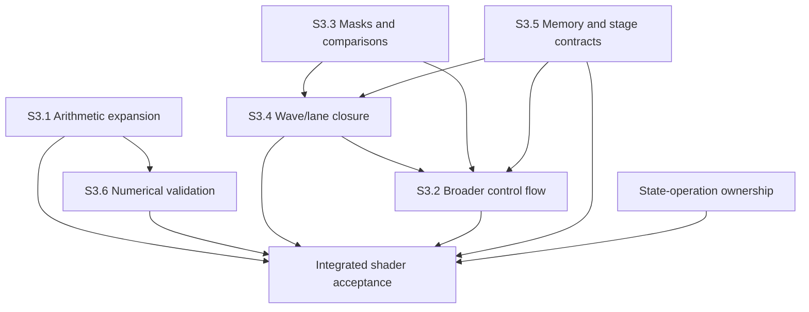

# Stage 3 shader roadmap and remaining effort

Reviewed 28 November 2026 against the generated [instruction checklist](shader-checklist.md)
and [validated checkpoints](../testing/stage3-control-memory-opening.md).
All six stages remain open. The inventory covers desktop gfx1030, not a proven
Xbox shader ISA or launch ABI. Decoding is not full semantic acceptance. The latest
[arithmetic checkpoint](../testing/local-graphics-checkpoint.md#stage-31-increment-xor-add-byte-average-and-masked-differences)
records the bounded XAD/LERP/MSAD validation separately. The subsequent
[MAD16 checkpoint](../testing/local-graphics-checkpoint.md#stage-31-increment-mixed-width-multiply-add)
adds the signed and unsigned low-halfword multiply-add forms with explicit
source and modifier restrictions.

The counts include the validated bounded MAD_U32_U16/MAD_I32_I16 pair.
Position-specific inline constants expand these existing forms without increasing
the decoded count. Full32 shared literals now retain low16 multiplicands and a
full32 accumulator, including negative literals emitted by LLVM. This extension
awaits independent acceptance; modifiers remain open.

The subsequent signed-subtraction increment adds bounded `V_SUB_NC_I32`
(opcode 886). Signed saturation is now implemented and awaits independent review;
broader modifiers remain open. See the
[signed-subtraction checkpoint](../testing/local-graphics-checkpoint.md#stage-31-increment-signed-subtraction-without-carry).

The signed-addition and byte-permutation increment adds two bounded forms.
Local native compute and graphics checks passed; independent acceptance remains
pending. See the [word-arithmetic checkpoint](../testing/local-graphics-checkpoint.md#stage-31-increment-signed-addition-and-byte-permutation).

The VOP3 encoding of `V_MOV_B32` now reuses the existing bit-preserving move
operation. Its canonical IR/display uses the existing move spelling while byte
lengths retain the actual encoding. Modifier forms and independent acceptance
remain open. Graphics retains the existing restrictions on non-finite immediate
values and direct scalar uniforms without validation metadata. See the
[move checkpoint](../testing/local-graphics-checkpoint.md#stage-31-increment-vop3-bit-preserving-move).

The byte-alignment increment adds `V_ALIGNBYTE_B32` with bounded sources and
five-bit count semantics in compute and integer graphics. Local native readbacks
and mutation detection passed; independent acceptance remains pending. See the
[byte-alignment checkpoint](../testing/local-graphics-checkpoint.md#stage-31-increment-byte-alignment).

## Whole-stage map

| Stage | Decoded / inventoried | Undecoded | Remaining work | Relative effort |
| --- | ---: | ---: | --- | --- |
| S3.1 Arithmetic | 168 / 480 | 312 | Wider/packed arithmetic, floating point, conversions, source and modifier modes | XL |
| S3.2 Control flow | 8 / 24 | 16 | Compute loops, calls/returns, divergence, debug/trap/halt and termination protocols | L–XL |
| S3.3 Masks and comparisons | 12 / 419 | 407 | Comparison predicates/types, dynamic EXEC, divergent lane state and reconvergence | XL |
| S3.4 Wave and lane | 11 / 11 | 0 | Broader operands, dynamic masks, partial populations, graphics/helper lanes and disputed semantics | L–XL |
| S3.5 Memory and interfaces | 14 / 509 | 495 | Address spaces, descriptors, LDS, atomics, images, ordering and stage interfaces | XL |
| S3.6 Numerical correctness | Cross-cutting | Not a separate instruction bucket | Rounding, special values, denormals, precision and differential tests | L–XL |
| State operations awaiting assignment | 0 / 22 | 22 | Classify ownership, define state/runtime contracts and implement | Uncertain |
| Inventory total | 213 / 1465 | 1252 | Includes the state bucket; excludes a second count for S3.6 | Not additive |

Effort bands are planning judgments, not measured completion percentages or
calendar promises. **L** means several substantial implementation-and-validation
increments; **XL** includes architectural work plus broad family expansion.
Full S3 is a months-scale engineering program, with low confidence in a fixed
finish date. A narrow operand addition can be much smaller than its parent stage.
Unresolved public semantics may block acceptance regardless of implementation speed.
Stages share prerequisites, so their effort must not be summed as independent tasks.

## Work breakdown

| Stage | Remaining work packages | Acceptance required |
| --- | --- | --- |
| S3.1 | Integer widths/carry behavior; FP arithmetic and conversion families; packed/mixed-width operations; legal source/literal/modifier variants; stage and mask integration | Independent exact or tolerance-defined results, encoding checks and native readback per admitted contract |
| S3.2 | Proven compute loops/live-out joins; two subvector-loop forms; four code-address/call forms; four debug predicates; four trap/halt forms; two specialized termination forms; dynamic divergence/reconvergence | Target boundaries, capture/alias behavior, bounded execution, explicit runtime events and memory interactions |
| S3.3 | Remaining typed comparison families/predicates; compare-and-update-EXEC operations; scalar/vector mask state; inactive-lane retention; nested divergence and reconvergence | Both mask halves, aliasing, empty/full/sparse masks, nested regions and cross-stage behavior |
| S3.4 | Special-register sources/selectors; broader runtime operand consumers; broader row-permutation operands; LDS-direct reads; dynamic EXEC; partial Wave64/shared VGPRs; graphics/helper lanes; masked rotation and inactive PERMLANE research | Independent lane membership and snapshots; no Metal SIMD-width assumptions; native boundary/negative cases and integrated review |
| S3.5 | MUBUF/MTBUF/SMEM descriptors/addressing; GLOBAL/FLAT/SCRATCH address spaces; LDS and atomics; MIMG sampling/stores/atomics; EXP/interpolation linkage; waits/barriers/cache visibility | Bounds, alignment, aliasing, pending-event ownership, synchronization scopes and stage-specific output |
| S3.6 | FP16/32/64 behavior where applicable; rounding/conversions; NaNs/infinities/signed zero; denormal handling; fused operations; transcendental accuracy; differential and mutation testing | Explicit numerical contract per operation; exact bits or justified bounds, with unsupported cases identified |
| State assignment | Audit the 22 provisional state forms and assign each to shader execution or runtime ownership | Explicit behavior and acceptance owner; no silent no-op substitutes |

These packages organize the work; they are not an exhaustive list of every
operand combination. The generated checklist retains every inventoried form.
The [control/wave/memory scope](control-wave-memory.md) lists the16 undecoded
control-flow forms and unresolved wave-operation semantics explicitly.

## What drives the workload

The 1,252 undecoded forms share implementation prerequisites. Shared
semantics and representations can cover many variants, but their encoding and
boundary tests still need evidence.

- Arithmetic: 312 missing forms include 37 scalar, 71 VOP1, 23 VOP2, 148 VOP3,
  29 packed VOP3P and 4 VOP3SDST forms. Paired registers, packed widths and mixed
  outputs are prerequisites for some families.
- Masks/comparisons: 178 missing VOPC and 191 VOP3 forms dominate the count.
  Shared comparison semantics help; dynamic EXEC and reconvergence are separate
  architectural work, not repetitive opcode additions.
- Memory/interfaces: 120 memory DS, 54 FLAT, 57 GLOBAL, 22 SCRATCH, 14 SMEM and
  16 MTBUF forms are absent, plus 69 MUBUF, 128 MIMG and one interpolation form.
  Transfer widths can share code; atomics, address spaces and barriers need
  distinct execution contracts.
- Numerical policy must accompany floating-point expansion. Some behavior may
  need software emulation if Metal does not supply the required semantics.

## Dependencies and execution order

The latest requested execution priority is S3.1 arithmetic expansion, superseding
the earlier wave/lane-first sequence. Required S3.3/S3.5 prerequisites and the
remaining S3.4 work stay open; the dependency graph does not prescribe a fixed
implementation order. Numerical validation accompanies each increment rather
than waiting until every instruction is implemented.

## Current S3.4 checkpoint

Implemented bounded compute support includes all 11 instruction identities,
explicit complete-wave Wave64, separate 32-lane DS routing, source snapshots,
selected-lane writes and inline/literal WRITELANE data. The latest constant-data
increment passed 762 native dispatches, including 132 new cases, with mutation
sensitivity verified. These are synthetic tests, not commercial-game coverage.

The subsequent full-wave runtime WRITELANE increment supports captured SGPR
selectors while constant selectors retain the partial-Wave32 contract. Its
combined native suite passed 810 dispatches, including 48 new cases. Validation
checks data/selector snapshots, per-wave values, replay contexts, EXEC-independent
writes and preservation of every other destination lane. See the checkpoint for
actual test results. Special-register operands and the other architectural gaps
listed above remain open.
